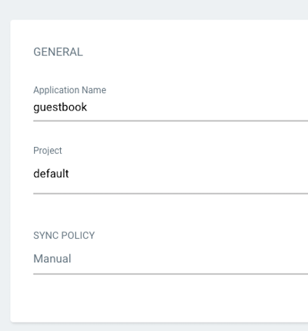
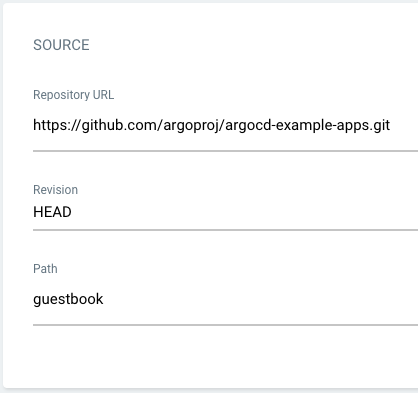
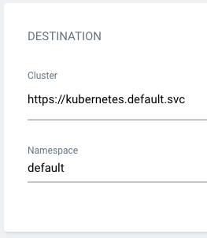

---
{
  "title": "Application",
  "description": "Veja a configuração de uma Application na interface e em YAML, com origem, destino e exemplos de Deployment e Service.",
  "type": "conceito",
  "stage": "implantar",
  "status": "em-estudo",
  "created": "2026-10-16",
  "updated": "2026-10-19",
  "tags": [
    "implantar",
    "conceito"
  ],
  "relations": [
    {
      "target": "conceitos/argo-cd",
      "kind": "configura"
    },
    {
      "target": "mapa",
      "kind": "documenta"
    }
  ]
}
---

## O problema que resolve

Argo CD instalado não sabe automaticamente qual projeto acompanhar nem onde implantar seus recursos. A Application registra essas instruções.

Ela é um recurso declarativo de configuração do Argo CD, registrado no Kubernetes. Não é o código do portal, um Pod ou um serviço que executa a sincronização.

## Como funciona

### Origem, destino e política

| Informação | Campo no YAML | Exemplo didático |
| --- | --- | --- |
| Repositório | `spec.source.repoURL` | URL do repositório de configurações |
| Revisão | `spec.source.targetRevision` | `main` |
| Pasta nessa revisão | `spec.source.path` | `deploy/portal` |
| Cluster | `spec.destination.server` | Endereço da API Kubernetes |
| Namespace de destino | `spec.destination.namespace` | `portal-homologacao` |
| Política | `spec.syncPolicy` | Sincronização manual ou automática e outras opções |

Repositório, revisão e caminho são campos separados. A Application aponta para a declaração do estado; os manifests nessa origem descrevem os recursos a criar ou atualizar.

### Como isso aparece na interface?

Para reconhecer o processo no portal: abra **New App**, preencha identificação e política, confira origem e destino e conclua em **Create**. Com política manual, criar a Application não equivale a implantar seus recursos: revise o diff e solicite **Sync** quando quiser aplicar.


Capturas oficiais do tutorial guestbook. Os valores das imagens pertencem ao tutorial; o exemplo YAML abaixo usa um portal fictício. A interface pode variar conforme a versão.



*Identificação: nome da Application, projeto Argo CD e política de sincronização. AppProject é um agrupamento de regras do Argo CD, não o repositório Git nem o namespace.*



*Origem: de onde obter a configuração. O caminho é relativo à raiz do repositório na revisão escolhida.*



*Destino: em qual cluster e namespace gerenciar os recursos. Informar a URL não concede acesso automaticamente; as permissões precisam existir.*

## No fluxo de entrega

Você pode criar a Application pela interface ou por um manifesto. Nos dois casos, o resultado é um recurso de configuração que os componentes do Argo CD acompanham.

O cluster e o Argo CD precisam existir primeiro. O manifesto inicial da Application precisa ser registrado por alguém ou por uma automação; apenas deixá-lo em uma pasta Git não faz uma instalação sem configuração encontrá-lo sozinha.

Cada Application pode gerenciar vários recursos. Mais tarde, [[conceitos/applicationset|ApplicationSet]] pode gerar várias Applications a partir de um modelo e dados de entrada. Ele não é necessário para entender ou criar a primeira Application.

## Exemplo

Exemplo estrutural com repositório fictício. Pressupõe Argo CD instalado, projeto `default` permitido e origem acessível. Não é um exercício pronto para executar sem adaptar a URL e fornecer os manifests.

```yaml
apiVersion: argoproj.io/v1alpha1
kind: Application
metadata:
  name: portal-homologacao
  namespace: argocd
spec:
  project: default
  source:
    repoURL: https://github.com/exemplo/configuracoes.git
    targetRevision: main
    path: deploy/portal
  destination:
    server: https://kubernetes.default.svc
    namespace: portal-homologacao
  syncPolicy:
    syncOptions:
      - CreateNamespace=true
```

- `metadata.namespace: argocd` indica onde este recurso Application fica registrado no exemplo.
- `destination.namespace` indica o namespace padrão dos recursos de destino que não especificarem um próprio.
- `https://kubernetes.default.svc` representa, neste exemplo, o cluster em que o Argo CD está instalado. Outro cluster requer cadastro/acesso apropriados.
- `CreateNamespace=true` solicita criar o namespace de destino durante Sync, com as permissões necessárias; não cria um cluster.
- O exemplo não habilita sincronização automática. Uma pessoa pode solicitar Sync.

Os arquivos acompanhados poderiam ser estes:

**`deploy/portal/deployment.yaml` — descreve a carga de trabalho.**

```yaml
apiVersion: apps/v1
kind: Deployment
metadata:
  name: portal
spec:
  replicas: 2
  selector:
    matchLabels:
      app: portal
  template:
    metadata:
      labels:
        app: portal
    spec:
      containers:
        - name: web
          image: nginx:1.28.0
          ports:
            - containerPort: 80
```

**`deploy/portal/service.yaml` — descreve o acesso interno aos Pods.**

```yaml
apiVersion: v1
kind: Service
metadata:
  name: portal
spec:
  selector:
    app: portal
  ports:
    - port: 80
      targetPort: 80
  type: ClusterIP
```

Usamos Nginx como conteúdo de demonstração, não como aplicação corporativa. A tag é ilustrativa, não uma recomendação de atualização. O Service seleciona Pods pelo rótulo `app: portal`; ele não cria os Pods. `ClusterIP` fornece acesso interno, não publica automaticamente o portal na internet.

## Como verificar

- Conferir a revisão e a pasta: a Application pode estar correta, mas apontar para arquivos diferentes dos que você editou.
- Separar namespace da Application e namespace dos recursos de destino.
- Conferir se o repositório e o cluster estão acessíveis com as permissões adequadas.
- Revisar os manifests gerados e o diff antes de sincronizar.
- Depois do Sync, conferir recursos, saúde e acesso ao serviço.

Nos dois manifests do exemplo, `selector.matchLabels`, os rótulos do modelo de Pod e o seletor do Service precisam ser coerentes. YAML válido sozinho não garante uma implantação correta.

## Conexões

- [[conceitos/argo-cd]] — ferramenta configurada pela Application.
- [[conceitos/gitops]] — contexto de operação orientada pelo estado desejado.
- [[conceitos/kubernetes]] — recebe os recursos declarados nos manifests.
- [[conceitos/applicationset]] — gera Applications quando precisamos organizar vários casos.
- [[mapa]] — localiza essas responsabilidades no jardim.

## Referências

- [Especificação da Application](https://argo-cd.readthedocs.io/en/stable/user-guide/application-specification/)
- [Opção CreateNamespace](https://argo-cd.readthedocs.io/en/stable/user-guide/sync-options/#create-namespace)
- [Criação pela interface e capturas oficiais](https://argo-cd.readthedocs.io/en/stable/getting_started/)
- [Deployments Kubernetes](https://kubernetes.io/docs/concepts/workloads/controllers/deployment/)
- [Services Kubernetes](https://kubernetes.io/docs/concepts/services-networking/service/)
- [Créditos e revisão das capturas](../assets/argocd/CREDITOS.txt)
- [Licença das imagens do projeto](../assets/argocd/LICENSE-ARGO-CD.txt)
