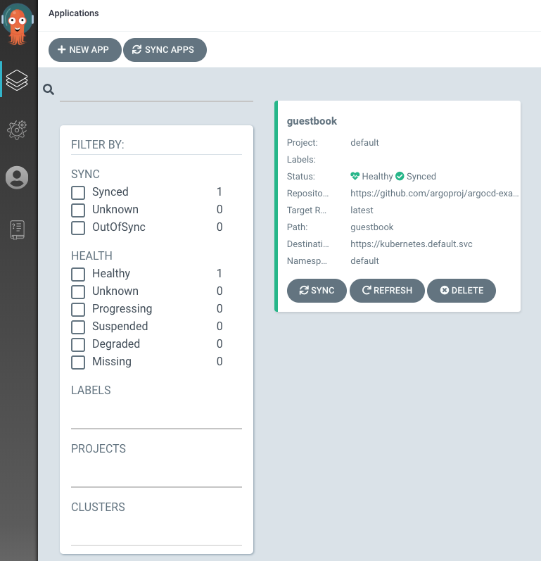
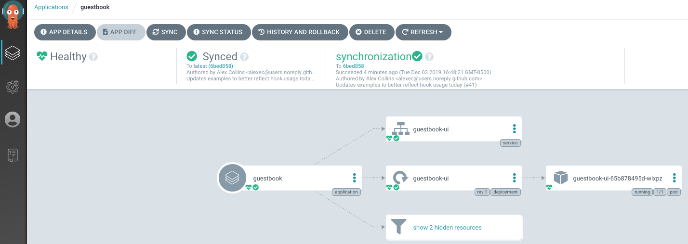
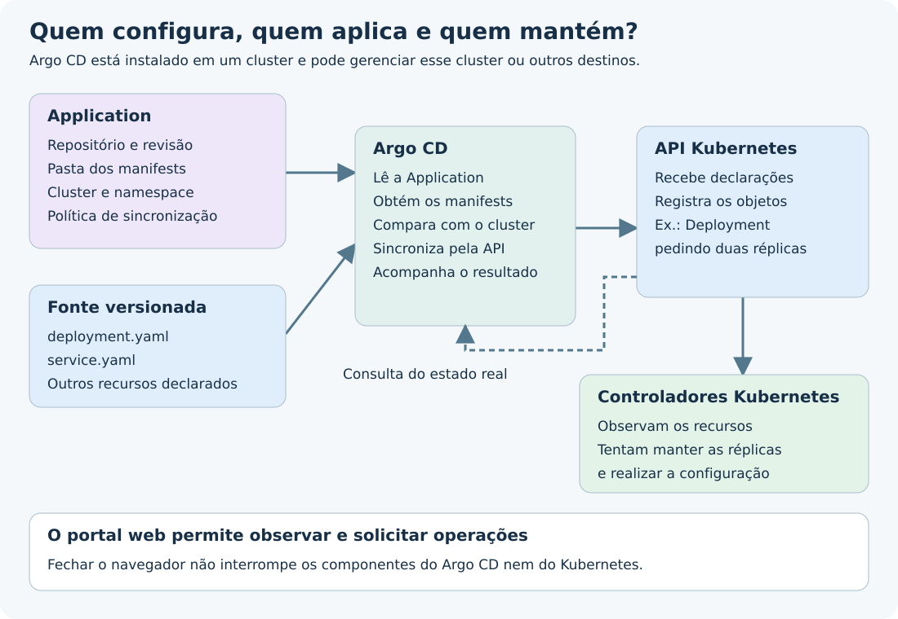

---
{
  "title": "Argo CD",
  "description": "Entenda onde o Argo CD executa, como a interface apresenta Applications e como ele compara e aplica configurações no Kubernetes.",
  "type": "conceito",
  "stage": "implantar",
  "status": "em-estudo",
  "created": "2026-10-16",
  "updated": "2026-10-19",
  "tags": [
    "implantar",
    "conceito"
  ],
  "relations": [
    {
      "target": "conceitos/kubernetes",
      "kind": "configura"
    },
    {
      "target": "mapa",
      "kind": "documenta"
    },
    {
      "target": "conceitos/gitops",
      "kind": "implementa"
    }
  ]
}
---

## O problema que resolve

Manter configurações de aplicações alinhadas à fonte versionada sem depender de entrar no cluster e repetir alterações manualmente.

Argo CD é uma ferramenta de entrega contínua para Kubernetes que implementa GitOps. Ele obtém a configuração desejada, compara com os recursos existentes e aplica mudanças quando uma sincronização é solicitada ou autorizada pela política automática.

## Como funciona

### Onde ele executa?

O Argo CD é instalado em um cluster Kubernetes e roda em Pods, frequentemente no namespace `argocd`. Sua interface web é uma maneira de acessá-lo; fechar o navegador não desliga seus componentes.

Uma instalação pode gerenciar o mesmo cluster e outros clusters cadastrados, desde que haja acesso de rede e permissões. Não é necessário instalar um Argo CD por aplicação, por máquina ou por cluster de destino. Instalações separadas podem ser adotadas por isolamento e organização.

### Quem informa o que ele deve acompanhar?

O recurso [[conceitos/application|Application]] contém origem, destino e política. Não é um serviço que faz a sincronização: os componentes do Argo CD leem essa configuração e executam o trabalho.

O repositório pode conter manifests prontos ou configurações de Helm/Kustomize que geram manifests. No fluxo normal, o resultado aplicado são objetos Kubernetes.

### Como o portal aparece?

As imagens abaixo são capturas reais da documentação pública do Argo CD, usando a aplicação de exemplo guestbook. Não são imagens de infraestrutura da RNP. A aparência e os campos podem variar conforme a versão instalada.

*Observe o nome da Application e as informações de sincronização e saúde. O cartão representa um conjunto gerenciado de recursos, não um Pod individual.*

*As ligações ajudam a inspecionar os recursos associados à Application. Elas mostram relações operacionais entre objetos; não são o mapa de estudos do jardim.*

## No fluxo de entrega

1. A infraestrutura inicial existe e o Argo CD está instalado.
2. São configurados os acessos necessários ao repositório e ao cluster.
3. Uma Application indica a origem e o destino.
4. Argo CD obtém os manifests e compara com os objetos existentes.
5. Ao sincronizar, envia mudanças à API Kubernetes.
6. Os controladores do Kubernetes trabalham para realizar a configuração recebida.

O namespace organiza recursos dentro do cluster; não identifica uma máquina. O endereço do cluster aponta para sua API.

Argo CD não compila a aplicação nem constrói a imagem. No fluxo estudado, a pipeline publica a imagem e uma pessoa ou automação atualiza sua referência na configuração acompanhada.

## Exemplo

Uma Application acompanha `main`, pasta `deploy/portal`, para implantar no namespace `portal-homologacao`.

| Mudança | Consequência |
| --- | --- |
| Alterei apenas uma branch de funcionalidade | A origem acompanhada em `main` ainda não mudou. |
| Atualizei a imagem em `main` | Argo CD pode detectar diferença em relação ao cluster. |
| Sincronização automática está desativada | A diferença pode aparecer, mas é necessário solicitar Sync para aplicá-la. |
| Um Pod foi removido, mas o Deployment ainda pede dois | Kubernetes tenta repô-lo; não precisa de novo commit ou Sync para pedir novamente a mesma quantidade. |

Mais de uma Application pode representar o mesmo software em ambientes diferentes. Por exemplo, `portal-dev` e `portal-prod` podem acompanhar configurações e destinos distintos.

## Como verificar

**Sync Status** informa se a configuração observada corresponde à desejada, segundo as regras de comparação. **Health** acompanha a condição dos recursos. Uma configuração sincronizada não garante que a aplicação esteja funcionando para o usuário.

Antes de Sync, confira origem, revisão, destino e diferenças propostas. Depois, acompanhe o resultado da operação, os recursos e o comportamento da aplicação.

A sincronização automática, a autocorreção de alterações no cluster (`selfHeal`) e a remoção de recursos que saíram da fonte (`prune`) são decisões distintas. Não assuma que toda opção está habilitada.

## Conexões

- [[conceitos/gitops]] — abordagem implementada pela ferramenta.
- [[conceitos/application]] — recurso que configura origem, destino e política.
- [[conceitos/kubernetes]] — API e controladores responsáveis pelos recursos e sua execução.
- [[mapa]] — relações entre os conceitos estudados.

## Referências

- [Argo CD: arquitetura](https://argo-cd.readthedocs.io/en/stable/operator-manual/architecture/)
- [Argo CD: conceitos centrais](https://argo-cd.readthedocs.io/en/stable/core_concepts/)
- [Argo CD: política de sincronização](https://argo-cd.readthedocs.io/en/stable/user-guide/auto_sync/)
- [Tutorial oficial e origem das capturas](https://argo-cd.readthedocs.io/en/stable/getting_started/)
- [Créditos das imagens e revisão de origem](../assets/argocd/CREDITOS.txt)
- [Licença Apache-2.0 das imagens do projeto](../assets/argocd/LICENSE-ARGO-CD.txt)
