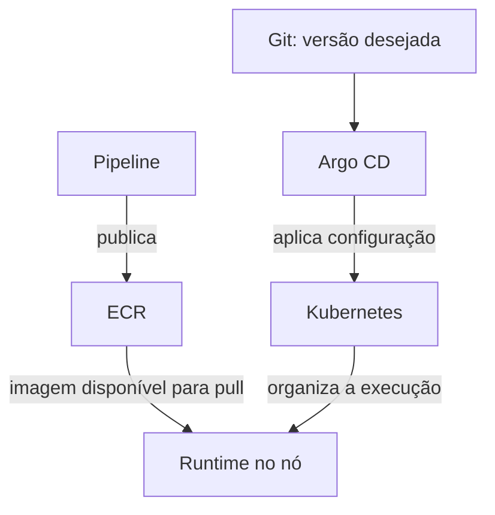

---
{
  "title": "ECR e versões",
  "description": "Disponibilizar imagens para consumidores autorizados. Entenda sua participação no ciclo de entrega.",
  "type": "conceito",
  "stage": "publicar",
  "status": "em-estudo",
  "created": "2026-10-16",
  "updated": "2026-10-21",
  "tags": [
    "publicar",
    "conceito"
  ],
  "relations": [
    {
      "target": "conceitos/registry",
      "kind": "implementa"
    }
  ]
}
---


## O problema que resolve

Disponibilizar imagens para consumidores autorizados.

## Como funciona

ECR é um serviço de registry. Em portal:v2, portal é o repositório e v2 é a tag escolhida por quem publica. Uma tag pode mudar se permitido; digest identifica o conteúdo.

## No fluxo de entrega

Publicar v2 não substitui containers v1. A configuração de implantação precisa selecionar a nova versão.

## Exemplo

Trecho didático; não é um arquivo completo.

```text
image: registry.example/portal:v2
```

### Veja a relação



## Como verificar

Confira tag/digest, permissão de pull e imagem efetivamente executada.

## Conexões

- [[conceitos/registry]] — ECR é um serviço que implementa essa responsabilidade.

## Referências

- [Documentação oficial](https://docs.aws.amazon.com/AmazonECR/latest/userguide/what-is-ecr.html)
