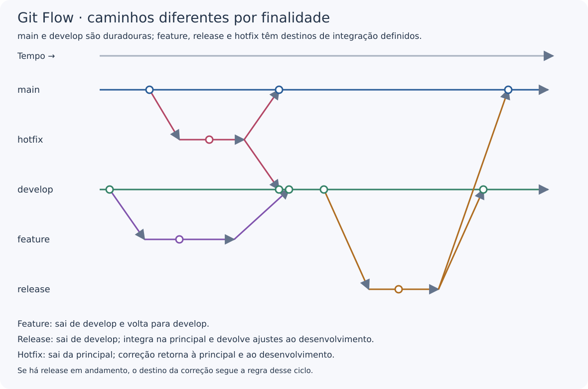

---
{
  "title": "Git Flow",
  "description": "Modelo de branches com main, develop e caminhos próprios para funcionalidades, releases e correções urgentes.",
  "type": "conceito",
  "stage": "planejar",
  "status": "em-estudo",
  "created": "2026-10-19",
  "updated": "2026-10-19",
  "tags": [
    "conceito",
    "planejar",
    "gitflow"
  ],
  "relations": [
    {
      "target": "conceitos/git",
      "kind": "depende-de"
    }
  ]
}
---

## O problema que resolve

Organizar o desenvolvimento da próxima versão enquanto uma versão publicada pode precisar de manutenção. Git Flow define papéis e caminhos de integração para branches.

## Como funciona

Mantém duas linhas duradouras: `main` (chamada `master` na proposta original) e `develop`. As branches auxiliares têm finalidade e destino definidos:

| Branch | Origem | Integração |
| --- | --- | --- |
| Funcionalidade | `develop` | `develop` |
| Release | `develop` | `main` e `develop` |
| Hotfix | `main` | `main` e `develop`, ou release em andamento |

Release prepara uma versão; hotfix trata uma correção urgente da versão publicada. Nem toda correção de bug é hotfix. Branches continuam sendo branches Git comuns: seus papéis vêm do processo.

## No fluxo de entrega

O modelo separa desenvolvimento e preparação de versões. Isso exige coordenar integrações, mas não significa que será sempre lento ou adequado a todo projeto.

Branches não são ambientes. Ter `develop` não cria um servidor de desenvolvimento, e uma branch permanente de homologação não é obrigatória no modelo.

## Exemplo

*Diagrama didático próprio. O tempo avança da esquerda para a direita. Linhas são branches, círculos são commits e setas diagonais indicam criação ou integração. Não representam ambientes nem uma hierarquia de máquinas.*

Quero adicionar uma busca ao portal. No exemplo, crio `feature/busca` a partir de `develop` e integro nela após revisar a mudança.

Quando o conjunto da próxima versão está definido, uma release permite prepará-lo antes da integração na principal. Fazer merge não executa, por si só, uma publicação: isso depende das automações do projeto.

## Como verificar

Antes de propor uma integração, identificar o papel da branch, sua origem e seu destino. Conferir se uma correção também precisa chegar às outras linhas mantidas.

Usar nomes como `feature/` não basta para caracterizar Git Flow: é preciso observar o caminho das mudanças.

## Conexões

- [[conceitos/git]] — fornece commits, branches e merges.
- [[conceitos/githubflow|GitHub Flow]] — alternativa com um fluxo mais simples pela principal.
- [[conceitos/trunk-based|Trunk-Based Development]] — enfatiza integração frequente e pouco isolamento.
- [[conceitos/gitops]] — abordagem de operação que pode coexistir com este modelo de desenvolvimento.

## Referências

- [Proposta original de Git Flow e reflexão do autor](https://nvie.com/posts/a-successful-git-branching-model/)
