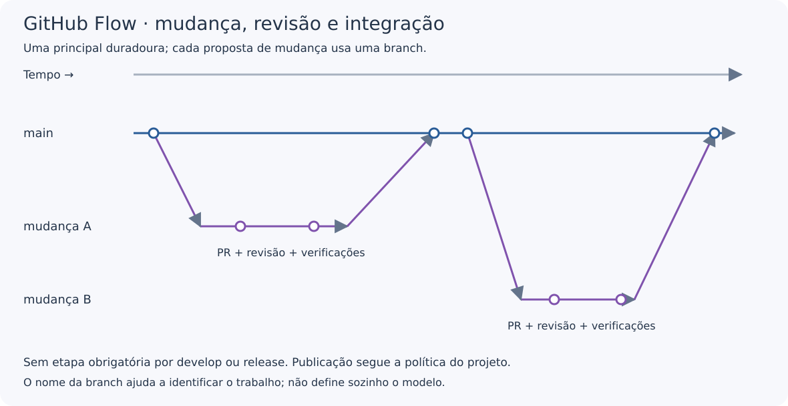

---
{
  "title": "GitHub Flow",
  "description": "Fluxo de colaboração em que mudanças saem da branch principal, passam por revisão e são integradas novamente nela.",
  "type": "conceito",
  "stage": "planejar",
  "status": "em-estudo",
  "created": "2026-10-19",
  "updated": "2026-10-19",
  "tags": [
    "conceito",
    "planejar",
    "githubflow"
  ],
  "relations": [
    {
      "target": "conceitos/git",
      "kind": "depende-de"
    }
  ]
}
---

## O problema que resolve

Organizar propostas e revisões de mudanças sem exigir uma linha permanente de desenvolvimento e um caminho separado de preparação de releases.

## Como funciona

A partir da principal, cria-se uma branch para uma mudança. Os commits são apresentados em um pull request, discutidos e revisados. Após as verificações necessárias, a mudança é integrada e a branch pode ser removida.

O modelo básico não exige `develop` permanente nem a sequência de branches de release do Git Flow. Nomes como `feature/` ou `fix/` ajudam na organização, mas não são sua definição.

## No fluxo de entrega

O time define como testar e publicar as mudanças. PR, merge e publicação são ações diferentes.

Adicionar uma `develop` duradoura e exigir que todas as mudanças passem por ela altera o fluxo básico; não é apenas uma diferença de nome.

GitHub é a plataforma. GitHub Flow é o fluxo de trabalho: a distinção é parecida com a que fizemos entre ferramenta e abordagem em GitOps.

## Exemplo

*Diagrama didático próprio. O tempo avança da esquerda para a direita. Linhas são branches, círculos são commits e setas diagonais indicam criação ou integração. Não representam ambientes nem uma hierarquia de máquinas.*

Quero esclarecer uma nota do jardim. Crio `docs/explicar-gitops` a partir da principal, altero o texto e abro um PR.

Confiro o diff, a validação e os comentários. Depois da integração, acompanho a pipeline de publicação. O PR aprovado não prova sozinho que o site foi atualizado.

## Como verificar

- A proposta tem objetivo compreensível?
- A origem e o destino da integração estão corretos?
- Revisão e verificações exigidas foram concluídas?
- A publicação necessária realmente terminou?

Não confundir “tem PR” com “segue GitHub Flow”: outros modelos também usam PRs.

## Conexões

- [[conceitos/git]] — registra as mudanças e permite integrá-las.
- [[conceitos/github|GitHub]] — plataforma em que praticamos esse fluxo.
- [[conceitos/gitflow|Git Flow]] — organiza outras linhas duradouras e caminhos de release.
- [[conceitos/trunk-based|Trunk-Based Development]] — pode se sobrepor ao fluxo quando as mudanças são pequenas e integradas frequentemente.
- [[conceitos/gitops]] — trata da operação, não da organização dos PRs.

## Referências

- [GitHub Flow: documentação oficial](https://docs.github.com/en/get-started/using-github/github-flow)
