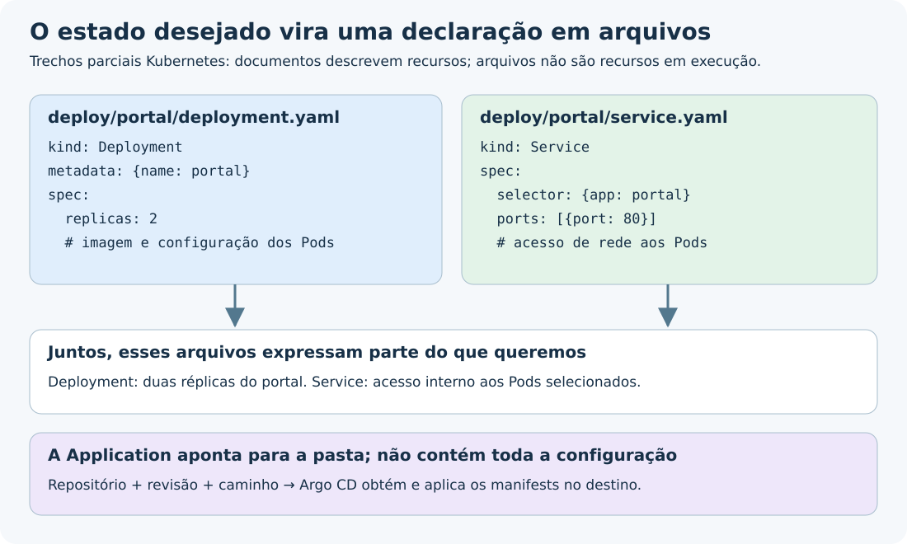

---
{
  "title": "GitOps",
  "description": "Gerenciar aplicações e infraestrutura com estado desejado versionado e reconciliação contínua. Diferencie a abordagem das ferramentas que a implementam.",
  "type": "conceito",
  "stage": "implantar",
  "status": "em-estudo",
  "created": "2026-10-16",
  "updated": "2026-10-19",
  "tags": [
    "conceito",
    "implantar",
    "gitops"
  ],
  "relations": [
    {
      "target": "conceitos/git",
      "kind": "depende-de"
    },
    {
      "target": "mapa",
      "kind": "documenta"
    }
  ]
}
---

## O problema que resolve

O que está funcionando no ambiente pode se afastar da configuração que esperamos. Alterações manuais também podem deixar o histórico do repositório diferente do que foi aplicado.

GitOps é uma abordagem para gerenciar aplicações e infraestrutura usando um estado desejado declarado e versionado, buscado e reconciliado continuamente por agentes de software. Não é uma ferramenta nem um modelo de branches.

## Como funciona

### O que significa estado desejado?

É a descrição de como queremos configurar os recursos: qual versão da aplicação executar, quantas réplicas manter e quais configurações usar. Não se limita a características físicas de máquinas.

O código da aplicação descreve sua lógica. A configuração de implantação descreve como executá-la. Ambos podem estar em arquivos versionados; não há contradição entre algo estar no Git e descrever um ambiente.

A declaração é o que queremos. O estado real é o que existe no ambiente. Um arquivo sozinho não cria recursos.

### O estado desejado é sempre Kubernetes?

Não. GitOps descreve uma forma de operar sistemas; não exige que o sistema seja Kubernetes. O que precisa existir é uma declaração versionada do estado desejado e agentes capazes de buscá-la e reconciliar o sistema correspondente.

No nosso exemplo com Argo CD, o resultado são manifests Kubernetes. Em outros sistemas, a declaração pode representar infraestrutura ou configuração de serviços, desde que exista uma implementação adequada dos princípios de GitOps.

| Arquivo ou conjunto | O que pode representar | Observação |
| --- | --- | --- |
| `deployment.yaml` | Imagem, réplicas e configuração dos Pods | Manifesto Kubernetes. |
| `service.yaml` | Como acessar um conjunto de Pods pela rede | Outro recurso Kubernetes; não é o portal web em si. |
| Chart Helm e valores | Modelos e parâmetros usados para gerar manifests | Argo CD pode gerar os manifests antes de comparar. |
| `kustomization.yaml` e patches | Alterações sobre manifests de uma base | Também produzem manifests Kubernetes. |
| Arquivos Terraform `.tf` | Recursos de infraestrutura, como redes e buckets | Declarar e versionar IaC não basta: um processo de plan/apply isolado não implica reconciliação contínua. Argo CD não executa Terraform nativamente como faz com manifests. |

YAML é formato, não sinônimo de estado desejado. Um workflow de CI também pode ser YAML, mas descreve tarefas de automação. O significado vem do conteúdo e da ferramenta que o interpreta.



*Diagrama didático próprio. O arquivo guarda uma declaração; os recursos reais existem no cluster. Os nomes de arquivos são exemplos, não exigências do GitOps.*

### Os quatro princípios

1. **Declarativo:** expressar o estado desejado.
2. **Versionado e imutável:** manter versões identificáveis e o histórico das declarações; uma mudança gera uma nova versão.
3. **Obtido automaticamente:** agentes buscam as declarações na fonte.
4. **Reconciliado continuamente:** agentes observam o ambiente e tentam aproximá-lo do estado desejado.

Pessoas definem o objetivo; ferramentas executam o processo. Detectar é perceber uma diferença; alertar é comunicá-la; reconciliar é agir sobre ela. Alertas ajudam, mas não substituem a reconciliação.

GitHub e GitLab são opções de hospedagem, não exigências. Podemos usar um servidor Git próprio. Argo CD é uma implementação possível; outro agente pode assumir essa responsabilidade. Os princípios do OpenGitOps descrevem as propriedades necessárias da fonte, sem exigir uma marca de hospedagem.

## No fluxo de entrega

No exemplo com Git, Argo CD e Kubernetes:

1. Uma pessoa altera e revisa a configuração versionada.
2. O Argo CD consulta a revisão e o caminho configurados.
3. Ele compara o estado desejado com os recursos do cluster e sincroniza conforme a política definida.
4. Kubernetes recebe a configuração e seus controladores trabalham para manter os recursos.

A sincronização pode exigir uma ação manual no Argo CD. Apenas instalar a ferramenta não significa ter configurado toda a automação de GitOps. A autocorreção de mudanças no ambiente também depende da política adotada.

Publicar uma imagem no registry não altera automaticamente a referência que está no Git. A atualização dessa referência é uma etapa própria, manual ou automatizada.

GitOps pode coexistir com Git Flow, GitHub Flow ou Trunk-Based Development: eles organizam a integração de mudanças; GitOps organiza a operação orientada pelo estado desejado.

## Exemplo

Trecho ilustrativo de um Deployment, não um manifesto completo:

```yaml
spec:
  replicas: 2
  template:
    spec:
      containers:
        - name: portal
          image: exemplo/portal:v2
```

A declaração pede dois Pods com a imagem indicada. Neste contexto, réplica significa réplica de Pod, não máquina; um Pod pode conter um ou mais containers.

| Situação | O que acontece |
| --- | --- |
| Git pede duas réplicas; a configuração do cluster pede uma | Argo CD pode detectar a divergência e sincronizar a configuração, conforme sua política. |
| Git e cluster pedem duas; um Pod foi removido | Kubernetes tenta repor o Pod usando a configuração que já recebeu. Não precisa de outro commit nem de uma nova sincronização do Argo CD. |

Não estamos supondo configuração manual: o Argo CD pode ter aplicado a configuração inicial. Entregar essa configuração e manter os Pods são responsabilidades diferentes.

## Como verificar

- Identificar o arquivo, a revisão e o destino que definem a entrega.
- Conferir se há um agente buscando e reconciliando a declaração.
- Verificar se a sincronização é automática ou depende de intervenção.
- Separar divergência de configuração de problemas de saúde da aplicação.
- Investigar falhas: reconciliar é tentar atingir o estado desejado, não garantir que sempre haverá recursos ou permissões suficientes.

Uma mudança manual pode ficar fora do histórico Git, mesmo que existam logs de auditoria no ambiente. Ela também pode ser sobrescrita por uma reconciliação posterior.

Guardar o arquivo e aplicá-lo manualmente, sem um processo contínuo de reconciliação com a fonte, não completa os princípios de GitOps.

## Conexões

[[conceitos/github|GitHub]] e [[conceitos/gitlab|GitLab]] podem hospedar a fonte versionada consultada pelos agentes. As setas indicam essa possibilidade, não uma ordem histórica nem uma exigência de fornecedor.

- [[conceitos/git]] — versiona as declarações no fluxo que estamos estudando.
- [[conceitos/argo-cd]] — ferramenta que implementa GitOps para Kubernetes.
- [[conceitos/kubernetes]] — recebe configurações e mantém os recursos no exemplo.
- [[conceitos/gitflow|Git Flow]], [[conceitos/githubflow|GitHub Flow]] e [[conceitos/trunk-based|Trunk-Based Development]] — organizam mudanças e integração, não substituem GitOps.
- [[mapa]] — apresenta as relações registradas entre os conceitos.

## Referências

- [Terraform: propósito da linguagem declarativa](https://developer.hashicorp.com/terraform/language)
- [Argo CD: ferramentas de configuração suportadas](https://argo-cd.readthedocs.io/en/stable/user-guide/tool_detection/)

- [Princípios do OpenGitOps](https://opengitops.dev/)
- [Argo CD: visão geral](https://argo-cd.readthedocs.io/en/stable/)
- [Argo CD: sincronização automática e autocorreção](https://argo-cd.readthedocs.io/en/stable/user-guide/auto_sync/)
- [Kubernetes: Deployments](https://kubernetes.io/docs/concepts/workloads/controllers/deployment/)
