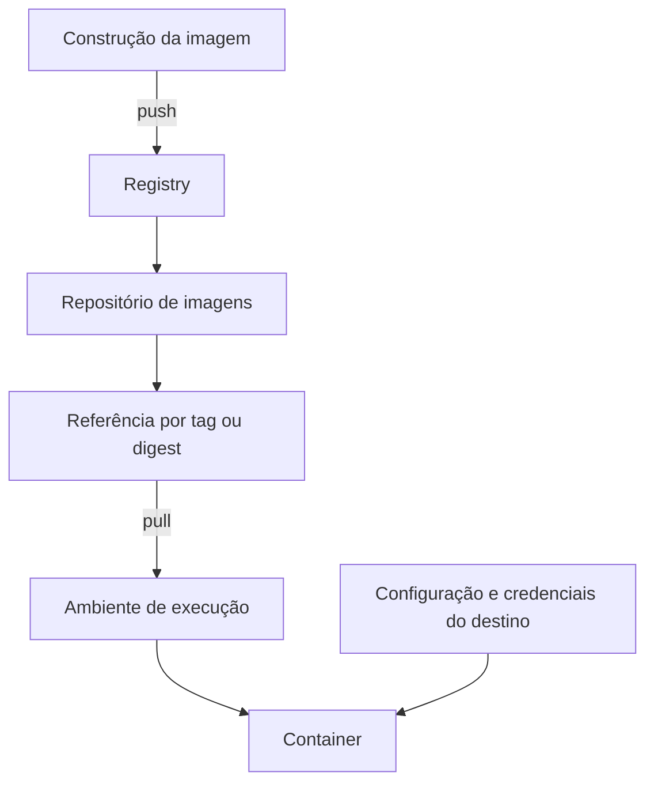

---
{
  "title": "Registry de imagens",
  "description": "Armazenamento e distribuição de imagens: diferenças entre registry, repositório de imagens, tag e repositório Git.",
  "type": "conceito",
  "stage": "publicar",
  "status": "em-estudo",
  "created": "2026-10-21",
  "updated": "2026-10-21",
  "tags": [
    "publicar",
    "conceito",
    "containers"
  ],
  "relations": [
    {
      "target": "conceitos/imagens",
      "kind": "armazena"
    }
  ]
}
---

## O problema que resolve

Disponibilizar imagens para outras máquinas e para implantações, sem depender da máquina que as construiu continuar disponível.

## Como funciona

Registry é o serviço que armazena e distribui imagens. Um repositório de imagens é uma coleção organizada dentro dele. Tags são nomes usados para referenciar imagens nessa coleção.

Um repositório Git guarda o histórico de arquivos do projeto. Um repositório de imagens guarda os artefatos preparados para execução. A palavra “repositório” aparece nos dois casos, mas o conteúdo e os comandos são diferentes.

## No fluxo de entrega

Depois da construção, um push publica a imagem. No destino, um pull baixa a imagem para uso. Baixar não inicia um container, e publicar uma versão não atualiza automaticamente as aplicações em execução.

Permissão para publicar e permissão para baixar podem ser diferentes. Credenciais de acesso ao registry também não são, necessariamente, as credenciais que a aplicação usa para acessar seu banco.

## Exemplo

Referência ilustrativa, sem indicar um serviço real disponível:

```text
registry.example/equipe/aplicacao:1.0
```

`registry.example` identifica o registry; `equipe/aplicacao`, o repositório; `1.0`, a tag. O pacote precisa existir ali e o consumidor precisa ter acesso para baixá-lo.

### Visualizando publicação e consumo



Registrar/publicar a imagem significa enviar seu conteúdo ao registry. Criar um repositório vazio prepara o local, mas ainda não publica nenhuma imagem.


Exemplo real da [documentação oficial](https://docs.docker.com/get-started/docker-concepts/the-basics/what-is-a-registry/): o Docker Hub é uma implementação de registry. Outros serviços têm interfaces diferentes. A tela cria o repositório; o push envia a imagem.

## Como verificar

Ao ler uma referência, consigo identificar onde a imagem está armazenada e qual versão foi selecionada? Sei distinguir falha de download de falha da aplicação depois de iniciar? A publicação prática ficará para outro momento.

## Conexões

- [[conceitos/imagens]] — artefatos armazenados pelo registry.
- [[conceitos/docker-hub]] — um serviço de registry.
- [[conceitos/ecr]] — outro serviço que exerce essa responsabilidade.
- [[conceitos/containers]] — usam as imagens obtidas, mas não são executados pelo simples armazenamento no registry.

## Referências

- [O que é um registry](https://docs.docker.com/get-started/docker-concepts/the-basics/what-is-a-registry/)
