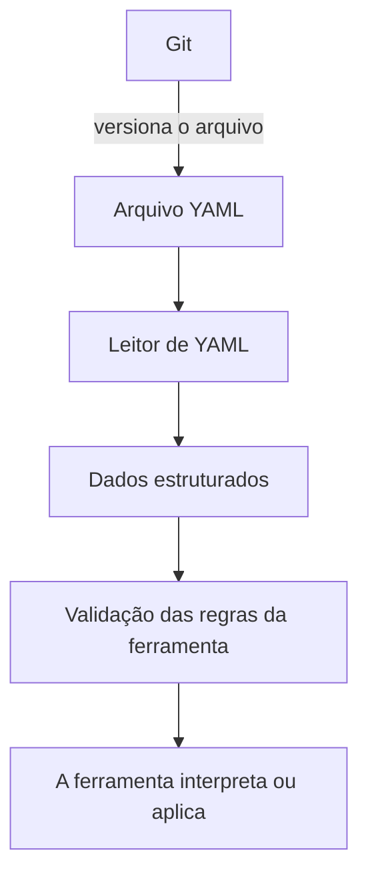

---
{
  "title": "YAML",
  "description": "Formato para representar dados e configurações: estrutura, listas, valores e a diferença entre sintaxe válida e configuração correta.",
  "type": "conceito",
  "stage": "construir",
  "status": "em-estudo",
  "created": "2026-10-16",
  "updated": "2026-10-21",
  "tags": [
    "construir",
    "conceito"
  ],
  "relations": [
    {
      "target": "mapa",
      "kind": "documenta"
    }
  ]
}
---


## O problema que resolve

Representar dados estruturados em texto legível, para que pessoas possam revisar e programas possam interpretar. YAML é uma linguagem de serialização de dados, usada com frequência como formato de configuração. Arquivos costumam usar `.yaml` ou `.yml`.

## Como funciona

YAML é um formato, não uma ferramenta de execução. Quem lê o arquivo define quais campos aceita e o que eles significam. Um arquivo de pipeline e um manifesto Kubernetes podem usar YAML, mas seguem contratos diferentes.

| Elemento | Como reconhecer |
|---|---|
| Mapa | Chaves associadas a valores, como `nome: estudo` |
| Lista | Itens com hífen em linhas separadas |
| Valor simples | Texto, número, booleano ou valor nulo |
| Hierarquia | Recuo com espaços; não usar tabulação para indentar |
| Comentário | Texto iniciado por `#`, fora de uma string |

Dois espaços por nível são uma convenção comum, não uma exigência universal. A consistência do recuo e a posição dos elementos é que definem a estrutura. Aspas ajudam a preservar valores como texto, por exemplo uma versão `"1.0"`.

## No fluxo de entrega

Git pode versionar arquivos YAML, assim como outros arquivos de texto. YAML não depende de Git e Git não depende de YAML. No mapa, a seta de Git para YAML significa somente **“versiona arquivos em”**; não significa origem, execução ou dependência.

YAML também representa configurações de pipelines, Docker Compose, Kubernetes e valores usados por Helm. Kustomize trabalha com recursos e customizações declarados em arquivos. Não é necessário dominar essas ferramentas para começar a ler a estrutura.

### Um arquivo válido ainda pode estar errado

A validação de sintaxe verifica se o texto é YAML bem formado. A validação da ferramenta verifica campos, tipos e regras que ela aceita. Uma configuração pode passar pelas duas e ainda apontar para um serviço indisponível.

Escrever `${DB_PASSWORD}` em YAML não busca uma senha por si só. É preciso que algum programa interprete essa expressão: um script pode substituir antes de aplicar, ou a aplicação pode resolver a variável durante a execução. O comportamento depende de quem lê o arquivo.

## Exemplo

Exemplo de dados para leitura; não é um manifesto Kubernetes nem um arquivo Compose executável.

```yaml
aplicacao:
  nome: estudo
  versao: "1.0"
  habilitada: true
  portas:
    - 8000
    - 9000
```

`aplicacao` contém um mapa. `nome`, `versao`, `habilitada` e `portas` pertencem a esse mapa. `portas` contém uma lista de dois números. Retirar o recuo de `portas` mudaria sua posição na estrutura.

### Veja o que acontece com o arquivo



Git guarda o histórico. O leitor transforma texto em dados. A ferramenta atribui significado aos campos. Essas responsabilidades são diferentes.

## Como verificar

Ao ler um arquivo, identifique os níveis de recuo, mapas, listas e valores. Depois pergunte qual ferramenta o lê e onde estão documentados os campos aceitos. Não coloque credenciais reais nos exemplos do jardim. A escrita e a validação prática serão exercitadas nos laboratórios.

## Conexões

- [[conceitos/git]] — pode versionar arquivos YAML. Esta é a única ligação do formato no mapa; não significa que YAML dependa de Git ou seja exclusivo dele.

[[mapa]] — localização no jardim, sem acrescentar outra ligação entre conceitos.

## Referências

- [Especificação YAML 1.2.2](https://yaml.org/spec/1.2.2/)
- [Objetos Kubernetes e seus manifestos](https://kubernetes.io/docs/concepts/overview/working-with-objects/)
