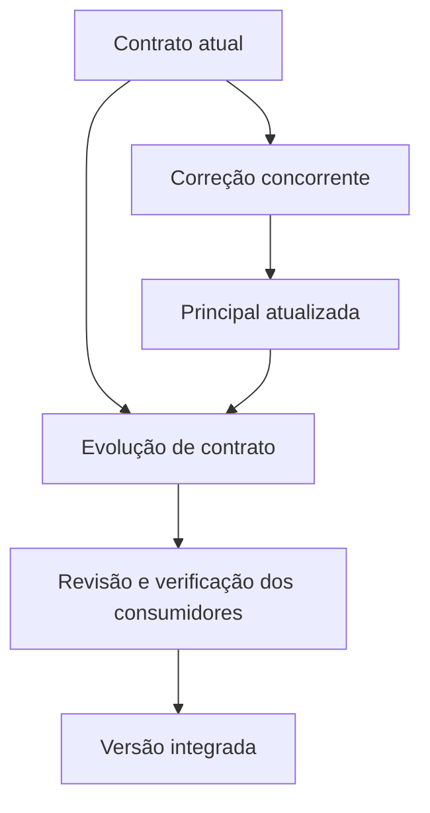

---
{
  "title": "01 · Entregar uma mudança compatível sem interromper o serviço",
  "description": "Incorporar a evolução do contrato e a correção concorrente usando branches curtas e revisão, preservando o comportamento do consumidor existente. GitHub Flow é o fluxo escolhido; sua lógica pode ser praticada no GitLab.",
  "type": "laboratorio",
  "stage": "aprender",
  "status": "em-estudo",
  "created": "2026-10-21",
  "updated": "2026-10-21",
  "tags": [
    "git",
    "githubflow",
    "github",
    "gitlab"
  ]
}
---

## Contexto

Uma equipe mantém um serviço de consulta usado por dois consumidores. O contrato atual retorna identificador, nome e situação de um recurso. Um novo consumidor precisa receber também a versão da aplicação e uma categoria opcional; o consumidor antigo não pode quebrar. Enquanto você prepara essa mudança, outra pessoa corrige o tratamento de recursos inexistentes. As duas entregas afetam o mesmo trecho. A demanda termina com uma versão revisada e utilizável na linha principal, acompanhada de instruções de recuperação.

## Objetivo da entrega

Incorporar a evolução do contrato e a correção concorrente usando branches curtas e revisão, preservando o comportamento do consumidor existente. GitHub Flow é o fluxo escolhido; sua lógica pode ser praticada no GitLab usando merge requests.

## Ponto de partida

Use o repositório desta demanda e a base de estudo fornecida. O ponto inicial deve demonstrar: consulta de recurso existente retorna os três campos atuais; consulta inexistente retorna uma resposta de erro definida. Uma implementação pequena ou fixture executável basta. Guarde um teste de cada comportamento antes de evoluir. Registre no README o contrato, o comando de execução e o de verificação. Não invente resultados de um serviço que ainda não foi preparado.

### Repositório desta demanda

Organização: [Jardim de Plataforma](https://github.com/jardim-plataforma). Nome previsto: `lab-01-entrega-compativel`. Crie-o nessa organização quando iniciar a prática; o pacote contém seu README e enunciado. O endereço previsto é `https://github.com/jardim-plataforma/lab-01-entrega-compativel` — ele só estará disponível depois da criação.

Comece da mesma base `servico-catalogo`, fornecida no pacote da organização. Os três fluxos partem de cópias independentes; não reutilize o resultado de um fluxo como ponto inicial de outro.

O README registra ponto de partida, como executar, como verificar e o link para este enunciado. Commits, PRs e arquivos de resolução ficam neste repositório. O texto de aprendizado pode ser publicado no jardim. Não é necessário criar projetos no GitLab.

## Desenvolvimento da demanda

### Delimitar a entrega

Descreva a resposta esperada pelos dois consumidores, quais campos são obrigatórios e como a versão será informada. Separe compatibilidade funcional de formatação interna. A principal precisa continuar utilizável durante o trabalho.

### Trabalhar com concorrência real

Parta de um commit inicial comum em duas cópias. Em uma, desenvolva os novos campos; em outra, corrija a resposta para recurso inexistente. Integre a correção primeiro. Atualize a branch da funcionalidade e confronte o diff com as duas intenções; resolva qualquer conflito sem perder a correção.

### Conduzir a revisão

Abra PR com contrato anterior, contrato proposto, resultados das verificações e impacto sobre consumidores. Incorpore uma solicitação de revisão na mesma proposta. Organize commits por mudanças compreensíveis, sem meta artificial de quantidade.

### Concluir e recuperar

Depois da integração, execute as verificações a partir de uma cópia limpa da principal. Provoque uma regressão de compatibilidade numa tentativa isolada e recupere por uma mudança rastreável. Diferencie integrar código de implantar um serviço.

## Incidente para investigar

A implementação nova funciona para o consumidor novo, mas remove um campo ainda usado pelo antigo. A revisão deve descobrir a regressão e a recuperação precisa preservar a correção concorrente.

## Critérios de conclusão

O resultado é uma mudança integrada com ambos os contratos atendidos, revisão rastreável, evidência do comportamento antes/depois e recuperação demonstrada. O diff faz parte da análise da entrega; não é o produto final. Sem outra pessoa disponível, a revisão independente fica explicitamente pendente.

As evidências fazem parte da entrega: resultados reproduzíveis, diferenças relevantes, histórico de revisão e observações do serviço devem sustentar suas conclusões. Escolha texto, logs, tabelas ou imagens conforme o que precisa demonstrar.

### Aceitação em uma entrega de equipe

O consumidor legado deve continuar aceitando uma resposta de sucesso e uma resposta de recurso inexistente; o consumidor novo deve receber os campos adicionais. Execute ambos a partir do mesmo commit integrado e demonstre que a correção concorrente foi preservada.

### Comparação com GitLab

No GitLab, a mesma proposta usa merge request, branches e revisão. GitHub Flow não obriga hospedar o código no GitHub. Nesta prática, a execução e a evidência serão no GitHub.

## Referências

- https://docs.github.com/en/get-started/using-github/github-flow
- https://docs.gitlab.com/user/project/merge_requests/
