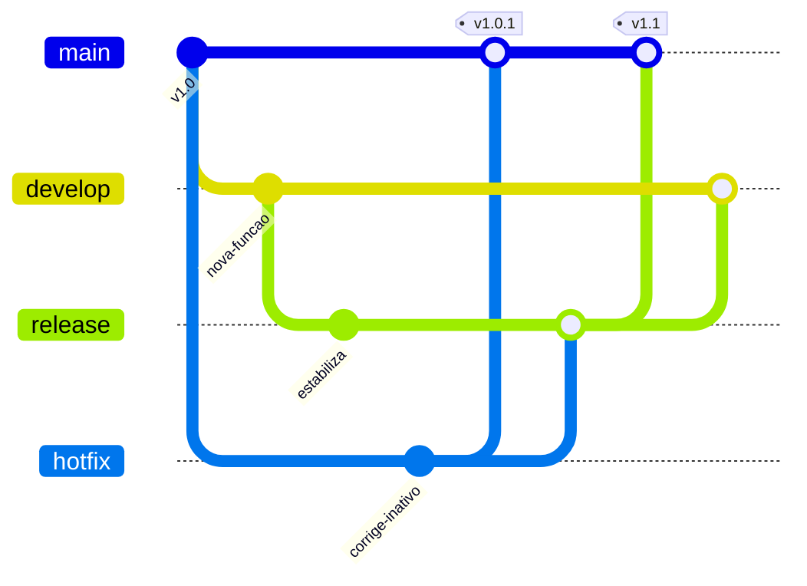

---
{
  "title": "02 · Publicar uma release enquanto atende uma correção urgente",
  "description": "Produzir uma versão corretiva da linha publicada e concluir a release planejada sem reintroduzir o defeito. O resultado deve explicar o percurso das mudanças entre main, develop, release e hotfix.",
  "type": "laboratorio",
  "stage": "aprender",
  "status": "em-estudo",
  "created": "2026-10-21",
  "updated": "2026-10-21",
  "tags": [
    "git",
    "gitflow",
    "gitlab",
    "github"
  ]
}
---

## Contexto

O serviço tem uma versão 1.0 publicada e uma 1.1 em estabilização. A próxima versão amplia a resposta de consulta, mas um incidente afeta a versão publicada: um recurso inativo está sendo apresentado como disponível. A equipe precisa corrigir o incidente sem levar junto a funcionalidade ainda não aprovada. A correção também deve sobreviver à próxima release.

## Objetivo da entrega

Produzir uma versão corretiva da linha publicada e concluir a release planejada sem reintroduzir o defeito. O resultado deve explicar o percurso das mudanças entre main, develop, release e hotfix.

## Ponto de partida

Use uma cópia independente do serviço da demanda anterior, com a mesma versão inicial registrada. A separação existe para comparar políticas de trabalho, não para representar ambientes. Use o repositório próprio desta demanda na organização jardim-plataforma. Use pull requests no GitHub. Prepare um caso de recurso inativo que reproduza o defeito e uma mudança ainda em estabilização na linha de desenvolvimento.

### Repositório desta demanda

Organização: [Jardim de Plataforma](https://github.com/jardim-plataforma). Nome previsto: `lab-02-release-e-correcao`. Crie-o nessa organização quando iniciar a prática; o pacote contém seu README e enunciado. O endereço previsto é `https://github.com/jardim-plataforma/lab-02-release-e-correcao` — ele só estará disponível depois da criação.

Comece da mesma base `servico-catalogo`, fornecida no pacote da organização. Os três fluxos partem de cópias independentes; não reutilize o resultado de um fluxo como ponto inicial de outro.

O README registra ponto de partida, como executar, como verificar e o link para este enunciado. Commits, PRs e arquivos de resolução ficam neste repositório. O texto de aprendizado pode ser publicado no jardim. Não é necessário criar projetos no GitLab.

## Desenvolvimento da demanda

### Preparar a versão futura

Organize main como linha publicada e develop como integração da próxima versão. Integre a funcionalidade a develop, abra a linha de release e explicite os critérios ainda pendentes para liberar 1.1.

### Responder ao incidente

Abra o hotfix a partir do commit publicado, reproduza o defeito e corrija somente o necessário. Revise contra essa linha: a alteração futura não pode entrar por acidente. Gere uma identificação de versão corretiva que corresponda ao código realmente entregue.

### Propagar a correção

Leve a correção às linhas de trabalho que precisam dela. Compare a implementação na release e em develop; resolva conflitos de intenção. Demonstre que a funcionalidade futura e a correção convivem.

### Fechar a release

Conclua a estabilização, integre e identifique a release. Revise o histórico e as diferenças entre a corretiva e a versão nova. Entregue notas de versão com impacto, verificação e caminho de recuperação.

## Incidente para investigar

O hotfix foi entregue na main, mas a release ainda contém o defeito. Descubra isso pelos casos de aceitação antes de publicar a release; não apenas pela presença de um commit com nome parecido.

## Critérios de conclusão

A versão corretiva não contém a funcionalidade incompleta, a release incorpora a correção e o histórico permite rastrear origem/destino. Tags correspondem a commits verificados. Criar branches não conta como criar ambientes de implantação.

As evidências fazem parte da entrega: resultados reproduzíveis, diferenças relevantes, histórico de revisão e observações do serviço devem sustentar suas conclusões. Escolha texto, logs, tabelas ou imagens conforme o que precisa demonstrar.

### Aceitação em uma entrega de equipe

Compare as saídas da versão publicada, da corretiva e da release. A correção precisa ser observada no comportamento de ambas as linhas, não inferida apenas pelo nome de um commit. Justifique o que pode ser revertido sem eliminar trabalho futuro.

### Comparação com GitLab

No GitLab, MR substitui PR na interface; a política de branches continua sendo Git Flow. Não é preciso criar uma cópia no GitLab para realizar a demanda.

## Referências

- https://nvie.com/posts/a-successful-git-branching-model/
- https://git-scm.com/docs/git-merge
