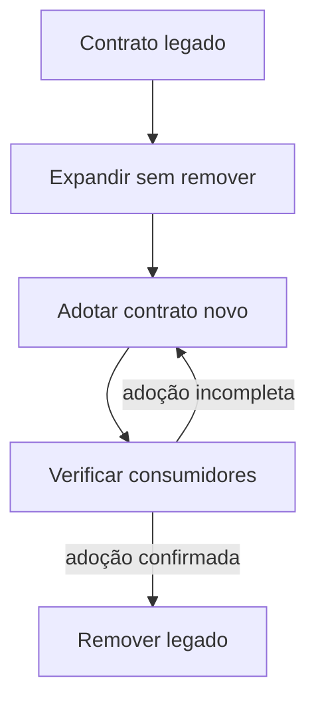

---
{
  "title": "03 · Evoluir um contrato por entregas pequenas e utilizáveis",
  "description": "Executar uma evolução compatível por incrementos integrados, mantendo a principal utilizável e demonstrando a diferença entre integrar código e habilitar comportamento.",
  "type": "laboratorio",
  "stage": "aprender",
  "status": "em-estudo",
  "created": "2026-10-21",
  "updated": "2026-10-21",
  "tags": [
    "git",
    "trunk-based",
    "github",
    "gitlab"
  ]
}
---

## Contexto

O serviço vai trocar o campo legado `status` por uma representação mais rica, mas consumidores antigos continuam em uso. O time não aceita manter uma branch isolada até a migração terminar: outras mudanças precisam continuar entrando na principal. A entrega deve permitir adoção gradual e recuperação antes da remoção definitiva do contrato antigo.

## Objetivo da entrega

Executar uma evolução compatível por incrementos integrados, mantendo a principal utilizável e demonstrando a diferença entre integrar código e habilitar comportamento.

## Ponto de partida

Use outra cópia independente do serviço inicial, no repositório desta demanda. Defina um consumidor legado e um consumidor novo como verificações reproduzíveis. A configuração que controla a exposição da resposta nova deve ser simples e documentada; não é necessário instalar uma plataforma de feature flags.

### Repositório desta demanda

Organização: [Jardim de Plataforma](https://github.com/jardim-plataforma). Nome previsto: `lab-03-evolucao-incremental`. Crie-o nessa organização quando iniciar a prática; o pacote contém seu README e enunciado. O endereço previsto é `https://github.com/jardim-plataforma/lab-03-evolucao-incremental` — ele só estará disponível depois da criação.

Comece da mesma base `servico-catalogo`, fornecida no pacote da organização. Os três fluxos partem de cópias independentes; não reutilize o resultado de um fluxo como ponto inicial de outro.

O README registra ponto de partida, como executar, como verificar e o link para este enunciado. Commits, PRs e arquivos de resolução ficam neste repositório. O texto de aprendizado pode ser publicado no jardim. Não é necessário criar projetos no GitLab.

## Desenvolvimento da demanda

### Planejar compatibilidade

Defina etapas de expansão, adoção e eventual remoção. Diga quais resultados precisam permanecer verdadeiros entre elas e o que permitirá considerar o consumidor antigo migrado.

### Integrar progresso

Implemente a estrutura nova mantendo a resposta antiga. Depois acrescente suporte ao consumidor novo sem habilitá-lo para todos. Integre cada incremento verificado por branches curtas; não acumule uma develop permanente ou trabalho indispensável apenas local.

### Habilitar e observar

Ative o comportamento novo por configuração e verifique os dois consumidores. Demonstre a diferença entre desabilitar uma opção e reverter código. Se uma etapa depender de mudança ainda não integrada, reorganize a entrega.

### Encerrar a migração

Remova o legado somente depois de demonstrar que deixou de ser necessário. Entregue a sequência de versões, resultados intermediários e justificativa de como cada ponto poderia ser utilizado por outra pessoa.

## Incidente para investigar

Um incremento passa no teste novo, mas depende de um arquivo que ficou apenas na máquina da autora. A verificação a partir de uma cópia limpa deve revelar o problema antes de prosseguir.

## Critérios de conclusão

A principal permanece verificável em cada integração; há evidência de compatibilidade durante a transição e de recuperação da habilitação. A conclusão explica a diferença para GitHub Flow: aqui a decomposição e a integração frequente são restrições centrais, não apenas a ausência de develop.

As evidências fazem parte da entrega: resultados reproduzíveis, diferenças relevantes, histórico de revisão e observações do serviço devem sustentar suas conclusões. Escolha texto, logs, tabelas ou imagens conforme o que precisa demonstrar.

### Aceitação em uma entrega de equipe

Demonstre pelo menos um estado intermediário utilizável, a ativação da mudança e sua desativação. Remover o contrato antigo só é permitido após comprovar a migração dos consumidores; registre o motivo de qualquer adiamento.

### Comparação com GitLab

A integração frequente e a decomposição não dependem do provedor. No GitLab você usaria MRs curtos; nesta prática usamos PRs no GitHub.

## Referências

- https://trunkbaseddevelopment.com/
- https://git-scm.com/docs
