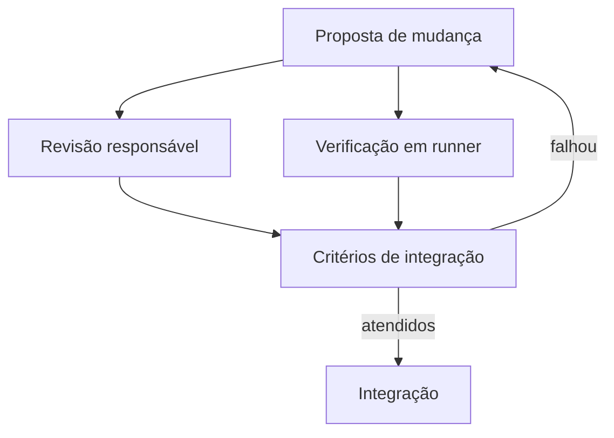

---
{
  "title": "04 · Preparar um repositório para contribuições revisáveis",
  "description": "Entregar um repositório em que uma proposta legítima percorre revisão e verificação, e uma proposta inválida é identificada antes da integração. Documentar o que a plataforma realmente impõe e o que depende de acordo humano.",
  "type": "laboratorio",
  "stage": "aprender",
  "status": "em-estudo",
  "created": "2026-10-21",
  "updated": "2026-10-21",
  "tags": [
    "git",
    "github",
    "gitlab",
    "pipeline"
  ]
}
---

## Contexto

O repositório do serviço será mantido por mais pessoas. Mudanças de código, empacotamento e implantação têm impactos diferentes; hoje qualquer alteração pode ser integrada sem critério claro. A equipe pede uma configuração mínima de colaboração que funcione de fato, com responsabilidades, verificação automática e tratamento adequado de configuração sensível.

## Objetivo da entrega

Entregar um repositório em que uma proposta legítima percorre revisão e verificação, e uma proposta inválida é identificada antes da integração. Documentar o que a plataforma realmente impõe e o que depende de acordo humano.

## Ponto de partida

Use o serviço já versionado. No GitHub, acesse Settings, regras de branch, Actions e Secrets and variables. A execução desta demanda ocorre somente no GitHub; a comparação com GitLab é conceitual. Use uma pessoa autorizada para a revisão independente. Recursos de aprovação podem depender do plano; ausência da função deve aparecer como limitação, não como controle implementado.

### Repositório desta demanda

Organização: [Jardim de Plataforma](https://github.com/jardim-plataforma). Nome previsto: `lab-04-governanca-da-entrega`. Crie-o nessa organização quando iniciar a prática; o pacote contém seu README e enunciado. O endereço previsto é `https://github.com/jardim-plataforma/lab-04-governanca-da-entrega` — ele só estará disponível depois da criação.

Importe um snapshot verificado de uma das demandas 01–03. Registre qual fluxo escolheu, a URL de origem e o commit. Não transfira políticas de branches de outros exercícios automaticamente.

O README registra ponto de partida, como executar, como verificar e o link para este enunciado. Commits, PRs e arquivos de resolução ficam neste repositório. O texto de aprendizado pode ser publicado no jardim. Não é necessário criar projetos no GitLab.

## Desenvolvimento da demanda

### Definir responsabilidades

Descreva quem pode propor, revisar e integrar mudanças nas pastas de aplicação, imagem e entrega. Configure CODEOWNERS quando disponível e compare indicação de responsável com exigência efetiva de aprovação. Não confunda CODEOWNERS com runners, que executam jobs.

### Automatizar uma verificação útil

Faça a pipeline executar os casos de contrato já usados nas demandas anteriores a partir do checkout do commit proposto. Identifique evento, job e runner. O foco é manter uma verificação pequena, não criar uma esteira completa de produção.

### Exercitar acesso e configuração

Forneça ao job uma variável de ambiente e um segredo fictício, sem gravá-lo no código nem imprimir seu valor. Verifique escopo e comportamento quando o valor estiver ausente. Distingua esse acesso da credencial que a aplicação precisará em execução.

### Validar o percurso inteiro

Abra uma proposta correta e outra que viola o contrato. Verifique responsáveis solicitados, execução, resultado e possibilidade de integração. Investigue também um job sem executor disponível: ele não equivale a um teste executado que falhou.

## Incidente para investigar

A regra de revisão está configurada, mas não se aplica à branch de destino, ou um caminho do CODEOWNERS não corresponde ao arquivo alterado. Uma proposta de teste precisa expor essa lacuna.

## Critérios de conclusão

Um terceiro consegue entender como contribuir, e os dois percursos de proposta têm resultados demonstrados. A matriz de permissões, as regras disponíveis, o check executado e as limitações estão documentados. Sem revisor, não declare aprovação independente.

As evidências fazem parte da entrega: resultados reproduzíveis, diferenças relevantes, histórico de revisão e observações do serviço devem sustentar suas conclusões. Escolha texto, logs, tabelas ou imagens conforme o que precisa demonstrar.

### Aceitação em uma entrega de equipe

Exercite uma proposta aprovada e uma que deva ser bloqueada. Identifique qual controle foi automático, qual dependeu de pessoa e qual não estava disponível. Diferencie falha do teste, falta de runner e falta de variável.

### Comparação com GitLab

Compare conceitualmente CODEOWNERS, regras de aprovação, Members e variáveis de CI/CD no GitLab com as configurações usadas no GitHub. Disponibilidade de controles varia por plano. A comparação não exige configurar a segunda plataforma.

## Referências

- https://docs.github.com/en/repositories/managing-your-repositorys-settings-and-features/customizing-your-repository/about-code-owners
- https://docs.gitlab.com/user/project/codeowners/
- https://docs.github.com/en/actions/get-started/understand-github-actions
