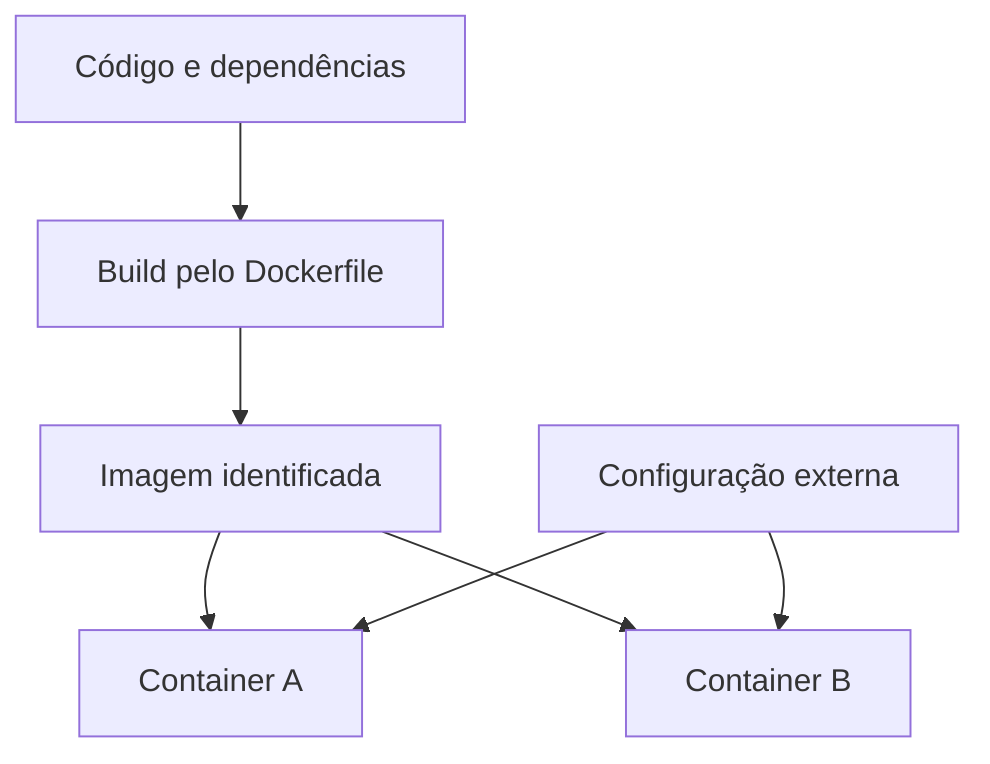

---
{
  "title": "05 · Distribuir um serviço que funcione fora da máquina de desenvolvimento",
  "description": "Entregar uma imagem reproduzível a partir de um commit e comprovar sua execução em dois containers independentes, distinguindo conteúdo do pacote, configuração de execução e recursos do host.",
  "type": "laboratorio",
  "stage": "aprender",
  "status": "em-estudo",
  "created": "2026-10-21",
  "updated": "2026-10-21",
  "tags": [
    "docker",
    "dockerfile",
    "imagens",
    "containers"
  ]
}
---

## Contexto

O serviço funciona no computador de quem desenvolveu, mas outra pessoa não consegue iniciar a mesma versão: dependências, diretórios e comando de execução diferem. A equipe quer uma imagem que carregue a aplicação e suas dependências, sem carregar configurações locais indevidas. Duas instâncias deverão executar simultaneamente para comparação, com configurações externas diferentes.

## Objetivo da entrega

Entregar uma imagem reproduzível a partir de um commit e comprovar sua execução em dois containers independentes, distinguindo conteúdo do pacote, configuração de execução e recursos do host.

## Ponto de partida

Use o serviço com um comando de inicialização conhecido e verificações de contrato. Registre linguagem/runtime, dependências, arquivos necessários, porta interna e parâmetros externos. Prepare Docker Engine ou ambiente compatível na máquina de estudo. Não é necessário Kubernetes. Se ainda não existe um serviço executável, prepare essa base primeiro; arquivos de mensagem soltos não comprovam execução de aplicação.

### Repositório desta demanda

Organização: [Jardim de Plataforma](https://github.com/jardim-plataforma). Nome previsto: `lab-05-servico-em-container`. Crie-o nessa organização quando iniciar a prática; o pacote contém seu README e enunciado. O endereço previsto é `https://github.com/jardim-plataforma/lab-05-servico-em-container` — ele só estará disponível depois da criação.

Use a saída pertinente da demanda 04 como entrada, registrando URL e commit de origem. Copie somente os arquivos necessários para este repositório; a continuidade do estudo não exige compartilhar o histórico de trabalho.

O README registra ponto de partida, como executar, como verificar e o link para este enunciado. Commits, PRs e arquivos de resolução ficam neste repositório. O texto de aprendizado pode ser publicado no jardim. Não é necessário criar projetos no GitLab.

## Desenvolvimento da demanda

### Mapear o pacote

Decida o que deve entrar na imagem: runtime, dependências e arquivos da aplicação. Separe disso credenciais, dados persistentes e parâmetros que variam por ambiente. Explique a escolha da base e o que o processo precisa para iniciar.

### Construir uma entrega verificável

Escreva Dockerfile e .dockerignore, configure diretório de trabalho e comando de início e construa a partir do commit escolhido. Verifique o conteúdo copiado. O Dockerfile deve produzir um serviço em execução, não depender de arquivos esquecidos fora do contexto de build.

### Executar em condições diferentes

Inicie duas instâncias da mesma imagem, com nomes e portas publicadas diferentes. Varie um parâmetro externo e confirme que as respostas refletem a configuração sem reconstruir. Diferencie porta em que o processo ouve da porta publicada no host.

### Entregar para outra execução

Faça outra pessoa ou uma máquina/ambiente limpo iniciar a mesma imagem. Mostre versão, resposta, logs e como parar/recriar. Documente o comando e as variáveis necessárias. Não conte o sucesso do build como prova de funcionamento.

## Incidente para investigar

A imagem é construída, mas o processo sai ao iniciar por caminho incorreto; em outra tentativa, o processo está ativo e a porta publicada não aponta para a porta em uso. Diagnostique por camadas, sem reconstruir a imagem para um erro apenas de configuração externa.

## Critérios de conclusão

A imagem está associada ao commit, dois containers usam o mesmo artefato e ambos atendem aos critérios do serviço. O procedimento funciona fora da configuração implícita da máquina original. O relato explica o limite entre imagem, container e ambiente.

As evidências fazem parte da entrega: resultados reproduzíveis, diferenças relevantes, histórico de revisão e observações do serviço devem sustentar suas conclusões. Escolha texto, logs, tabelas ou imagens conforme o que precisa demonstrar.

### Aceitação em uma entrega de equipe

Reproduza o funcionamento fora do diretório de desenvolvimento. Comprove o que acontece ao encerrar o processo principal e ao recriar o container, além de distinguir processo ativo de aplicação respondendo corretamente.

### Comparação com GitLab

O Dockerfile e a imagem não dependem de GitHub ou GitLab. No GitLab, mudariam a hospedagem do código e, se automatizado, o formato da pipeline.

## Referências

- https://docs.docker.com/build/concepts/dockerfile/
- https://docs.docker.com/engine/containers/run/
- https://docs.docker.com/engine/network/port-publishing/
