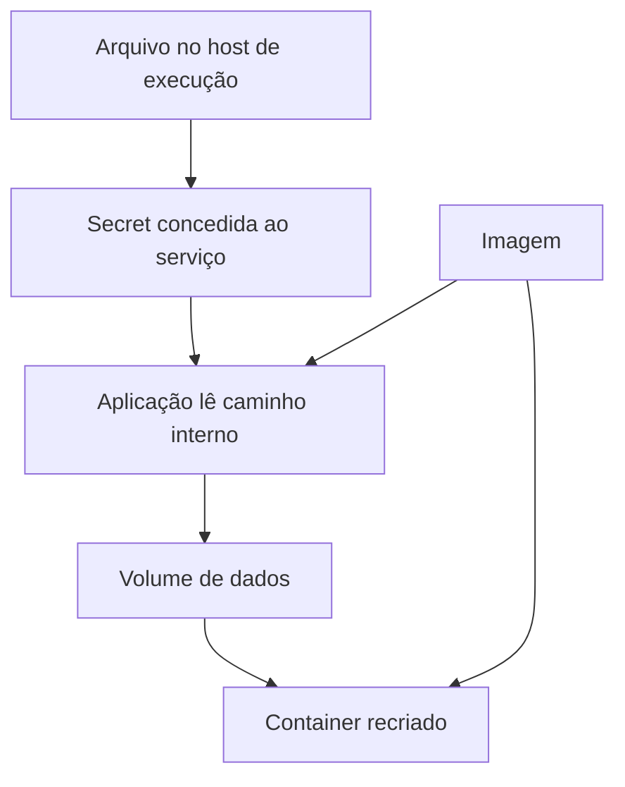

---
{
  "title": "06 · Manter dados e configuração ao substituir containers",
  "description": "Entregar configuração de execução com persistência e fornecimento explícito de secrets no destino, demonstrando recriação, alteração de configuração e recuperação de falhas.",
  "type": "laboratorio",
  "stage": "aprender",
  "status": "em-estudo",
  "created": "2026-10-21",
  "updated": "2026-10-21",
  "tags": [
    "docker",
    "containers",
    "secrets",
    "volumes"
  ]
}
---

## Contexto

O serviço passou a salvar registros e consultar um recurso protegido. A primeira substituição do container apagou os registros locais, e uma colega tentou resolver a autenticação copiando uma senha para dentro da imagem. A demanda é permitir substituir a execução sem perder os dados e trocar a credencial sem construir outra imagem.

## Objetivo da entrega

Entregar configuração de execução com persistência e fornecimento explícito de secrets no destino, demonstrando recriação, alteração de configuração e recuperação de falhas.

## Ponto de partida

Use a imagem da demanda anterior. Ela precisa escrever um registro em um caminho configurável e ler uma credencial fictícia de um arquivo configurável; acrescente essas capacidades por uma mudança revisada se não existirem. O recurso protegido pode ser um serviço local de teste. Use Docker Compose para declarar a execução. O arquivo de origem da secret existe na máquina que executa o Compose, não na máquina histórica do build.

### Repositório desta demanda

Organização: [Jardim de Plataforma](https://github.com/jardim-plataforma). Nome previsto: `lab-06-continuidade-do-servico`. Crie-o nessa organização quando iniciar a prática; o pacote contém seu README e enunciado. O endereço previsto é `https://github.com/jardim-plataforma/lab-06-continuidade-do-servico` — ele só estará disponível depois da criação.

Use a saída pertinente da demanda 05 como entrada, registrando URL e commit de origem. Copie somente os arquivos necessários para este repositório; a continuidade do estudo não exige compartilhar o histórico de trabalho.

O README registra ponto de partida, como executar, como verificar e o link para este enunciado. Commits, PRs e arquivos de resolução ficam neste repositório. O texto de aprendizado pode ser publicado no jardim. Não é necessário criar projetos no GitLab.

## Desenvolvimento da demanda

### Definir a continuidade

Identifique quais dados precisam permanecer, onde o processo grava e o que pode ser descartado. Separe o diretório persistente dos arquivos da aplicação e descreva como verificar um registro antes e depois da recriação.

### Fornecer a configuração

Declare o serviço, seu volume e a secret no Compose. Na declaração geral da secret, indique a origem; no serviço, conceda acesso; na configuração da aplicação, indique o caminho interno que ela deve ler. Não são três cópias da senha, mas responsabilidades diferentes.

### Substituir e alterar

Crie registros, remova/recrie somente o container e verifique a persistência. Troque o arquivo fictício e reaplique/recrie conforme necessário para a aplicação reler o valor. Mantenha a mesma referência de imagem e mostre que a configuração mudou no destino.

### Investigar o limite

Teste arquivo de origem ausente, caminho interno incorreto e ausência de permissão. Identifique em qual camada cada falha aparece. Documente a diferença entre remover container e remover volume, sem destruir dados de outras tentativas.

## Incidente para investigar

Na segunda máquina, a imagem existe, mas a secret de origem não. O serviço não deve procurar o computador onde a imagem foi construída. A recuperação exige fornecer a configuração à máquina de execução e validar a leitura interna.

## Critérios de conclusão

Os registros sobrevivem à substituição do container, a credencial fictícia não entra na imagem nem no Git e sua troca é demonstrada. O procedimento informa que persistência não equivale a backup e que reverter uma imagem não restaura dados apagados.

As evidências fazem parte da entrega: resultados reproduzíveis, diferenças relevantes, histórico de revisão e observações do serviço devem sustentar suas conclusões. Escolha texto, logs, tabelas ou imagens conforme o que precisa demonstrar.

### Aceitação em uma entrega de equipe

Recrie a execução com os dados persistidos e a mesma imagem. Demonstre a diferença entre permissão de leitura, caminho incorreto e arquivo de origem ausente; a recuperação deve explicar onde a configuração foi fornecida.

### Comparação com GitLab

Uma variável de CI/CD cadastrada no GitLab, assim como uma secret de Actions, não aparece automaticamente no container de destino. O fornecimento de configuração precisa ser explícito nas duas plataformas.

## Referências

- https://docs.docker.com/compose/how-tos/use-secrets/
- https://docs.docker.com/engine/storage/volumes/
