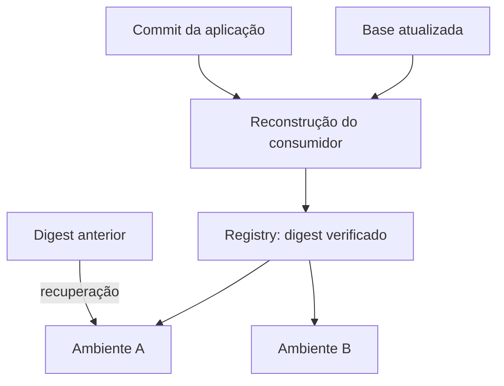

---
{
  "title": "07 · Publicar uma versão e promover o mesmo artefato",
  "description": "Entregar publicação e consumo rastreáveis de uma imagem, incorporar uma atualização da base por reconstrução explícita e promover o artefato aprovado pelo mesmo digest.",
  "type": "laboratorio",
  "stage": "aprender",
  "status": "em-estudo",
  "created": "2026-10-21",
  "updated": "2026-10-21",
  "tags": [
    "dockerfile",
    "imagens",
    "registry",
    "dockerhub"
  ]
}
---

## Contexto

A equipe precisa distribuir o serviço para consumidores que não têm acesso ao diretório de desenvolvimento. Uma atualização da base também está disponível, mas as imagens consumidoras antigas não mudaram. Ao promover uma versão aprovada para outro ambiente, alguém propôs fazer um novo build; isso criaria um artefato diferente daquele que foi verificado.

## Objetivo da entrega

Entregar publicação e consumo rastreáveis de uma imagem, incorporar uma atualização da base por reconstrução explícita e promover o artefato aprovado pelo mesmo digest.

## Ponto de partida

Use a aplicação empacotada e escolha um repositório de imagens no Docker Hub. O endereço concreto entra nesta demanda e na configuração de entrega, não fica fixado no índice dos laboratórios. Prepare autenticação para publicar e um consumidor separado do build. ECR, replicação regional, assinatura e multiarch ficam fora deste escopo.

### Repositório desta demanda

Organização: [Jardim de Plataforma](https://github.com/jardim-plataforma). Nome previsto: `lab-07-publicacao-e-promocao`. Crie-o nessa organização quando iniciar a prática; o pacote contém seu README e enunciado. O endereço previsto é `https://github.com/jardim-plataforma/lab-07-publicacao-e-promocao` — ele só estará disponível depois da criação.

Use a saída pertinente da demanda 06 como entrada, registrando URL e commit de origem. Copie somente os arquivos necessários para este repositório; a continuidade do estudo não exige compartilhar o histórico de trabalho.

O README registra ponto de partida, como executar, como verificar e o link para este enunciado. Commits, PRs e arquivos de resolução ficam neste repositório. O texto de aprendizado pode ser publicado no jardim. Não é necessário criar projetos no GitLab.

## Desenvolvimento da demanda

### Publicar com identidade

Defina a referência, uma tag que permita reconhecer a versão e sua associação ao commit. Publique e registre o digest resolvido pelo registry. Verifique que a imagem pode ser consumida sem copiar os arquivos de desenvolvimento.

### Investigar atualização da base

Construa o consumidor com uma base identificada. Atualize a base e compare o consumidor anterior, que permanece o mesmo pacote. Reconstrua o consumidor de forma explícita, verifique-o e publique uma nova referência; explique como a base entrou no resultado.

### Promover sem reconstruir

Use o digest aprovado em duas configurações de ambiente. Varie apenas o que pertence à execução. Prove qual referência cada consumidor recebeu; a existência de uma tag local, sozinha, não demonstra consumo do registry.

### Recuperar uma referência anterior

Simule uma publicação que não atende aos critérios e mantenha a versão aprovada disponível. Volte a configuração do consumidor para o artefato conhecido e confirme o comportamento. Documente quais tags/digests não devem ser removidos antes da recuperação.

## Incidente para investigar

Uma tag foi reapontada e dois consumidores passaram a resolver versões diferentes. Use as referências efetivamente resolvidas para investigar, sem assumir que nomes iguais representam conteúdos iguais.

## Critérios de conclusão

Outra execução consome a versão publicada, a atualização de base gera um consumidor novo e os dois ambientes promovidos usam o mesmo digest. A rastreabilidade liga código, build, registry e execução, com recuperação comprovada.

As evidências fazem parte da entrega: resultados reproduzíveis, diferenças relevantes, histórico de revisão e observações do serviço devem sustentar suas conclusões. Escolha texto, logs, tabelas ou imagens conforme o que precisa demonstrar.

### Aceitação em uma entrega de equipe

Compare digest publicado e digest efetivamente consumido; registre a relação com o commit e a base. Um rebuild por atualização da base deve produzir uma entrega novamente verificada; promover entre ambientes não deve executar esse rebuild.

### Comparação com GitLab

GitLab Container Registry é outra possibilidade de registry. Aqui mantemos Docker Hub para exercitar publicação/consumo, enquanto todo o código e histórico da prática ficam no GitHub.

## Referências

- https://docs.docker.com/get-started/introduction/build-and-push-first-image/
- https://docs.docker.com/build/building/best-practices/
