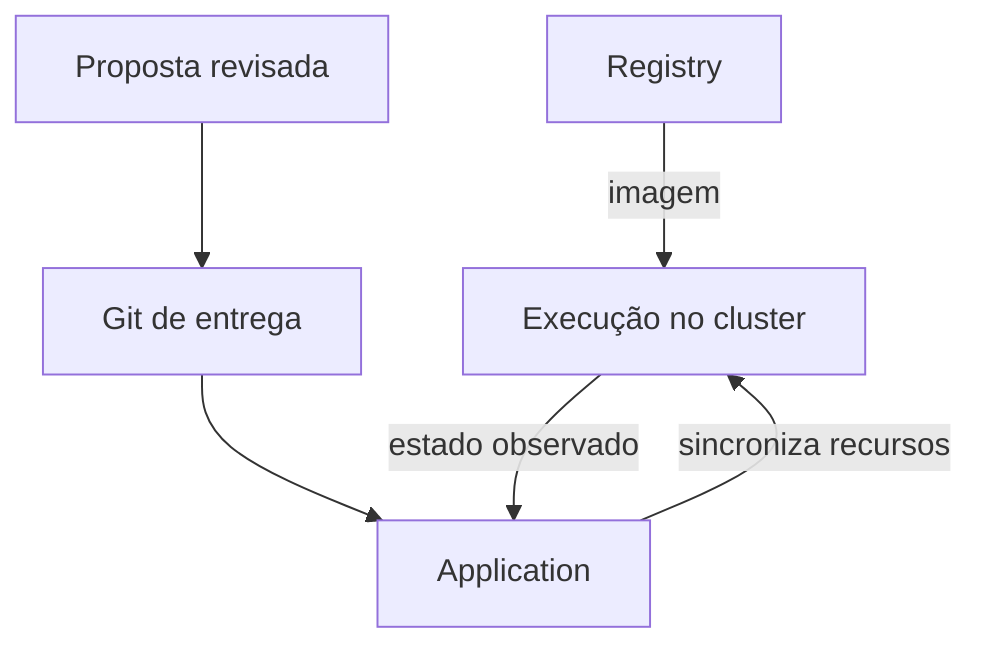

---
{
  "title": "08 · Implantar pelo Git e diagnosticar uma entrega incompleta",
  "description": "Entregar um repositório de configuração e uma Application que sincronize um serviço de estudo, permitindo explicar fonte, revisão, caminho, destino, sincronização e saúde.",
  "type": "laboratorio",
  "stage": "aprender",
  "status": "em-estudo",
  "created": "2026-10-21",
  "updated": "2026-10-21",
  "tags": [
    "gitops",
    "argo-cd",
    "application",
    "imagens"
  ]
}
---

## Contexto

O serviço já tem uma imagem publicada, mas a decisão de implantação ainda depende de alguém executar comandos manualmente. A equipe quer separar publicação do artefato e alteração do ambiente, revisar a versão desejada e observar a diferença entre o declarado e o executado. A primeira implantação deverá ser acompanhada no Argo CD, incluindo um incidente de entrega.

## Objetivo da entrega

Entregar um repositório de configuração e uma Application que sincronize um serviço de estudo, permitindo explicar fonte, revisão, caminho, destino, sincronização e saúde.

## Ponto de partida

Use o digest verificado na demanda de publicação e use o repositório desta demanda como repositório de entrega. Para a parte operacional, prepare um cluster local descartável e Argo CD conforme a documentação. A introdução necessária a Kubernetes limita-se a cluster, namespace, Deployment, imagem e acesso. Sem cluster, a revisão dos arquivos é uma entrega parcial explicitamente identificada.

### Repositório desta demanda

Organização: [Jardim de Plataforma](https://github.com/jardim-plataforma). Nome previsto: `lab-08-implantacao-gitops`. Crie-o nessa organização quando iniciar a prática; o pacote contém seu README e enunciado. O endereço previsto é `https://github.com/jardim-plataforma/lab-08-implantacao-gitops` — ele só estará disponível depois da criação.

Este repositório guarda a configuração de entrega. Consuma a imagem publicada na demanda 07; o código e o build continuam identificados naquele repositório. Não é necessário criar um repositório extra chamado entrega-estudo.

O README registra ponto de partida, como executar, como verificar e o link para este enunciado. Commits, PRs e arquivos de resolução ficam neste repositório. O texto de aprendizado pode ser publicado no jardim. Não é necessário criar projetos no GitLab.

## Desenvolvimento da demanda

### Declarar a implantação

Organize uma pasta por ambiente com manifestos mínimos e a referência da imagem. Descreva o que deve existir e o que indica funcionamento. Abra proposta de alteração separada da publicação do artefato: publicar no registry não atualiza esse arquivo automaticamente.

### Configurar a Application

Defina repoURL, targetRevision, path, projeto e destino. Confirme acesso à fonte e namespace disponível. Comece com sincronização manual, para inspecionar o plano e os recursos antes da aplicação. A Application configura o gerenciamento; não substitui os manifestos do serviço.

### Observar a primeira entrega

Na interface, confira os dados da Application, diff, revisão e recursos. Sincronize e verifique a aplicação. Registre separadamente manifestos sincronizados e execução saudável; um estado não garante o outro.

### Investigar e recuperar

Introduza uma referência de imagem inexistente numa proposta de estudo, observe o resultado e recupere pela alteração revisada do Git. Depois teste uma mudança manual de campo gerenciado e compare o comportamento com selfHeal desabilitado e habilitado, quando estiver pronta para essa política.

## Incidente para investigar

O Argo CD aplicou a configuração, mas o serviço não funciona por uma imagem inexistente. Não tente resolver alterando branches aleatoriamente: compare revisão, referência de imagem, eventos e execução. A reposição de um Pod pelo Kubernetes é outra responsabilidade.

## Critérios de conclusão

A Application usa fonte e destino corretos, uma versão atende aos critérios do serviço e a falha foi recuperada com rastreabilidade. É possível explicar como o Kubernetes recebeu a configuração e distinguir reconciliação do Argo CD da manutenção local dos recursos.

As evidências fazem parte da entrega: resultados reproduzíveis, diferenças relevantes, histórico de revisão e observações do serviço devem sustentar suas conclusões. Escolha texto, logs, tabelas ou imagens conforme o que precisa demonstrar.

### Aceitação em uma entrega de equipe

Observe uma alteração fora da branch acompanhada, uma alteração na branch acompanhada antes de Sync e uma sincronização com falha de execução. Explique os três resultados e recupere o serviço pela fonte Git.

### Comparação com GitLab

O Argo CD também pode ler Git hospedado no GitLab: mudariam repoURL e credenciais de acesso. A responsabilidade de reconciliar permanece a mesma.

## Referências

- https://argo-cd.readthedocs.io/en/stable/getting_started/
- https://argo-cd.readthedocs.io/en/stable/user-guide/application-specification/
- https://argo-cd.readthedocs.io/en/stable/user-guide/auto_sync/
