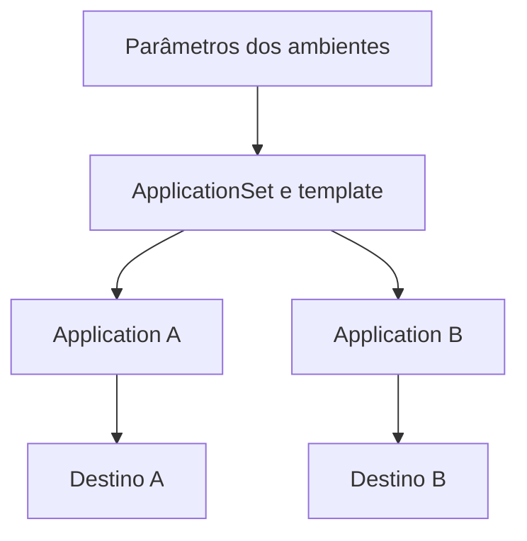

---
{
  "title": "09 · Substituir cadastros repetidos por Applications geradas",
  "description": "Migrar um cenário de estudo para ApplicationSet, com parâmetros explícitos, Applications previsíveis e uma estratégia de transição e recuperação.",
  "type": "laboratorio",
  "stage": "aprender",
  "status": "em-estudo",
  "created": "2026-10-21",
  "updated": "2026-10-21",
  "tags": [
    "gitops",
    "argo-cd",
    "application",
    "applicationset"
  ]
}
---

## Contexto

Dois ambientes do serviço são gerenciados por Applications cadastradas separadamente. Os arquivos repetem configurações e já divergem em revisão, caminho e política. A equipe quer padronizar a criação sem perder as diferenças legítimas de cada ambiente nem fazer dois recursos gerenciarem o mesmo conjunto de objetos.

## Objetivo da entrega

Migrar um cenário de estudo para ApplicationSet, com parâmetros explícitos, Applications previsíveis e uma estratégia de transição e recuperação.

## Ponto de partida

Use o repositório de entrega e a Application já observada em execução. Prepare uma segunda configuração de ambiente e inventarie nomes, namespaces, paths, referências e políticas atuais. Comece com List generator; não é necessário introduzir descoberta automática de clusters. Uma ApplicationSet não cria por si só a infraestrutura de destino.

### Repositório desta demanda

Organização: [Jardim de Plataforma](https://github.com/jardim-plataforma). Nome previsto: `lab-09-applications-geradas`. Crie-o nessa organização quando iniciar a prática; o pacote contém seu README e enunciado. O endereço previsto é `https://github.com/jardim-plataforma/lab-09-applications-geradas` — ele só estará disponível depois da criação.

Importe a configuração de entrega da demanda 08 com sua origem registrada. Faça a migração num destino de estudo separado ou desative o gerenciamento anterior de forma planejada: duas Applications não devem disputar os mesmos recursos.

O README registra ponto de partida, como executar, como verificar e o link para este enunciado. Commits, PRs e arquivos de resolução ficam neste repositório. O texto de aprendizado pode ser publicado no jardim. Não é necessário criar projetos no GitLab.

## Desenvolvimento da demanda

### Separar padrão de variação

Monte uma tabela dos dois ambientes e identifique campos comuns e diferentes. Defina os nomes finais das Applications e os recursos que cada uma deve gerenciar. Preserve isolamento de destino e diferenças intencionais.

### Construir a geração

Escreva o ApplicationSet com parâmetros e template. Preveja nomes, paths e destinos antes de aplicar. Revise colisões e variáveis ausentes. Gere primeiro em um cenário isolado para confirmar que o template representa o inventário.

### Planejar a transição

Defina como retirar o cadastro manual sem excluir acidentalmente a aplicação e sem duas Applications disputarem os mesmos recursos. Confira finalizers, políticas de sincronização e preservação/exclusão antes da mudança. Só então execute a transição no ambiente de estudo.

### Operar e recuperar

Atualize um parâmetro de um ambiente e confira o efeito. Provoque uma entrada incorreta e recupere a declaração. Explique o que acontece ao remover uma entrada, distinguindo remover a Application de preservar ou excluir seus recursos; não experimente exclusão sem plano.

## Incidente para investigar

Duas entradas geram o mesmo nome, ou uma alteração de path faz uma Application assumir recursos indevidos. A revisão do conjunto gerado deve revelar isso antes da sincronização.

## Critérios de conclusão

As Applications geradas correspondem ao inventário, cada destino está isolado e não há gerenciadores concorrentes. A transição e o retorno ao estado anterior estão documentados e testados no escopo permitido. Gerar recursos sem sincronizá-los não equivale a comprovar implantação.

As evidências fazem parte da entrega: resultados reproduzíveis, diferenças relevantes, histórico de revisão e observações do serviço devem sustentar suas conclusões. Escolha texto, logs, tabelas ou imagens conforme o que precisa demonstrar.

### Aceitação em uma entrega de equipe

Valide os parâmetros dos dois ambientes e um caso de nome duplicado ou parâmetro ausente antes da sincronização. Explique o comportamento de exclusão e demonstre o plano de transição sem dois gerenciadores concorrentes.

### Comparação com GitLab

O gerador e o template de ApplicationSet não dependem de GitHub. Trocar o provedor da fonte não elimina a necessidade de controlar nomes, paths, destinos e políticas.

## Referências

- https://argo-cd.readthedocs.io/en/stable/user-guide/application-set/
- https://argo-cd.readthedocs.io/en/stable/operator-manual/applicationset/Controlling-Resource-Modification/
