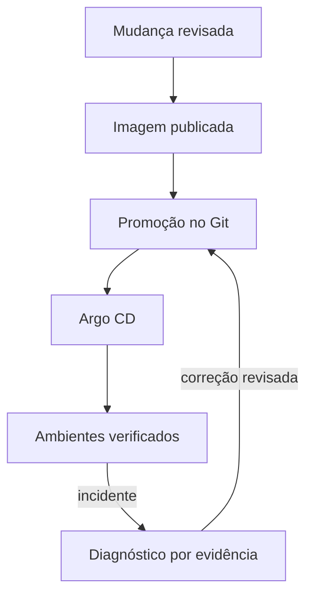

---
{
  "title": "10 · Assumir uma entrega e recuperar um incidente ponta a ponta",
  "description": "Concluir uma entrega rastreável, localizar e recuperar um incidente e produzir uma passagem de conhecimento utilizável por outra pessoa, dentro das ferramentas já estudadas.",
  "type": "laboratorio",
  "stage": "aprender",
  "status": "em-estudo",
  "created": "2026-10-21",
  "updated": "2026-10-21",
  "tags": [
    "git",
    "docker",
    "registry",
    "gitops",
    "argo-cd",
    "applicationset"
  ]
}
---

## Contexto

Você recebe a continuidade de um serviço: há código, imagem publicada, configuração de entrega e Applications, mas a documentação não explica claramente o que já foi verificado. Uma nova versão deve chegar a dois ambientes e uma falha será introduzida durante a entrega. A equipe precisa de alguém que localize a implementação, faça uma mudança controlada e deixe a operação compreensível para a próxima pessoa.

## Objetivo da entrega

Concluir uma entrega rastreável, localizar e recuperar um incidente e produzir uma passagem de conhecimento utilizável por outra pessoa, dentro das ferramentas já estudadas.

## Ponto de partida

Reúna os projetos e artefatos das demandas anteriores. Prepare uma solicitação concreta de mudança do serviço e defina seus critérios de funcionamento. Escolha uma pessoa autorizada para revisar e introduzir uma falha no ambiente de estudo; sem essa pessoa, declare que o cenário foi autoinduzido. Não é necessário AWS, provisionamento corporativo nem implementação avançada de pipeline.

### Repositório desta demanda

Organização: [Jardim de Plataforma](https://github.com/jardim-plataforma). Nome previsto: `lab-10-entrega-e-recuperacao`. Crie-o nessa organização quando iniciar a prática; o pacote contém seu README e enunciado. O endereço previsto é `https://github.com/jardim-plataforma/lab-10-entrega-e-recuperacao` — ele só estará disponível depois da criação.

Reúna a configuração e a documentação necessárias das demandas anteriores, registrando suas origens. Use este repositório para a entrega final; referencie as imagens e o código já existentes sem fingir que foram produzidos novamente aqui.

O README registra ponto de partida, como executar, como verificar e o link para este enunciado. Commits, PRs e arquivos de resolução ficam neste repositório. O texto de aprendizado pode ser publicado no jardim. Não é necessário criar projetos no GitLab.

## Desenvolvimento da demanda

### Receber a continuidade

Identifique o que existe, o que falta, onde estão os arquivos e quem consome a entrega. Reconstrua a cadeia entre versão do código, imagem e declaração de implantação. Registre incertezas antes de agir.

### Entregar a mudança

Escolha o fluxo adequado ao cenário, explique a escolha e conduza revisão e verificações. Construa e publique a imagem. Promova o mesmo digest entre os dois ambientes pelo Git de entrega e acompanhe o Argo CD.

### Diagnosticar sob restrição

A falha pode estar em acesso à fonte, imagem, configuração, path, destino ou execução. Formule hipóteses, procure evidências e registre por que descartou alternativas. Evite alterar várias camadas ao mesmo tempo, pois isso impede saber qual intervenção resolveu.

### Recuperar e transferir

Recupere uma versão conhecida sem apagar o histórico. Verifique o serviço e os dados que precisam permanecer. Entregue uma explicação operacional que permita a outra pessoa localizar recursos, verificar saúde, repetir a entrega e recuperar o incidente.

## Incidente para investigar

O código revisado está correto, mas um ambiente aponta para um digest anterior ou recebe configuração incompleta. O diagnóstico precisa partir do observado em cada camada, sem tomar o sucesso do build como confirmação da entrega.

## Critérios de conclusão

Os dois ambientes atendem aos critérios com o artefato identificado; a falha e a recuperação têm evidência; outra pessoa ou uma segunda execução limpa reproduz o procedimento. A conclusão indica o que você consegue executar, onde precisa de apoio e quais temas ficaram fora do escopo.

As evidências fazem parte da entrega: resultados reproduzíveis, diferenças relevantes, histórico de revisão e observações do serviço devem sustentar suas conclusões. Escolha texto, logs, tabelas ou imagens conforme o que precisa demonstrar.

### Aceitação em uma entrega de equipe

Outra pessoa deve conseguir identificar o artefato em uso e o caminho de recuperação pelo material entregue. Se fizer a validação sozinha, use uma cópia limpa e registre esse limite. Aponte em que momento pediria apoio em um ambiente real.

### Comparação com GitLab

A passagem de conhecimento precisa ligar código, imagem e implantação em qualquer plataforma. No GitLab, os links de revisão e execução seriam MR e pipeline; nesta entrega serão PR e Actions.

## Referências

- https://git-scm.com/docs
- https://docs.docker.com/
- https://argo-cd.readthedocs.io/en/stable/
