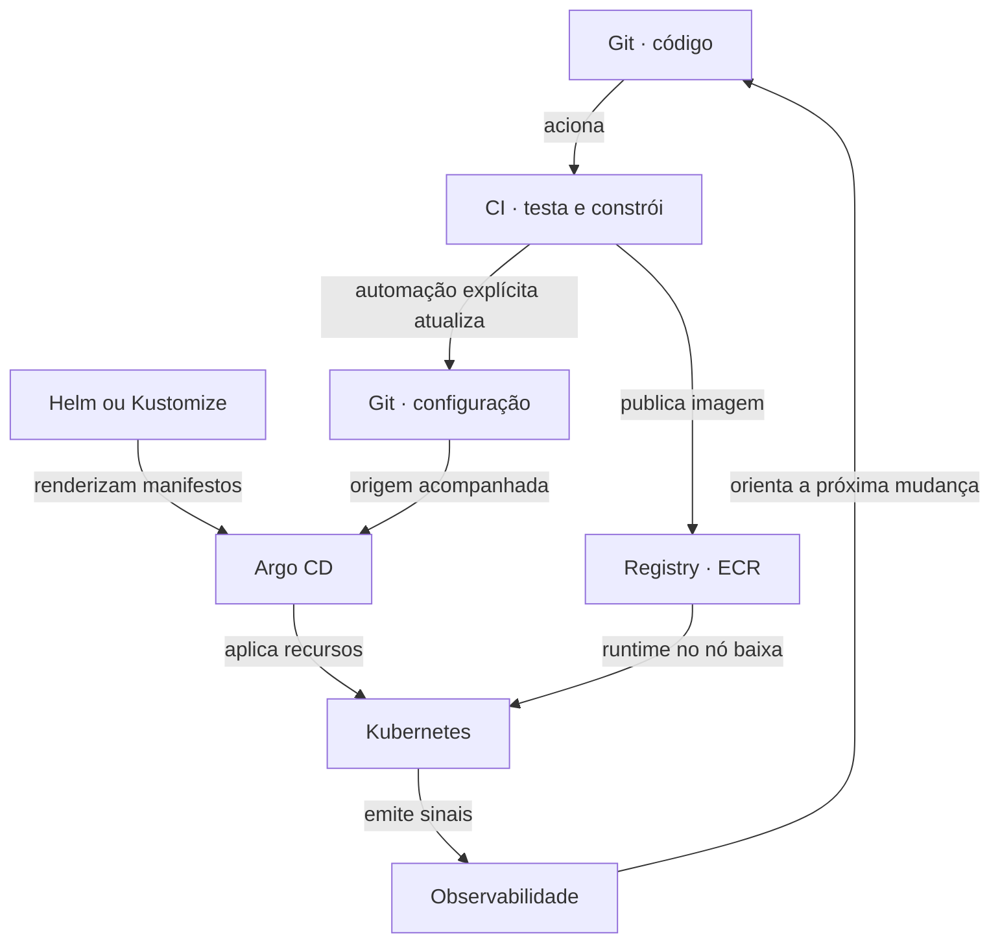

---
{
  "title": "O ciclo de entrega",
  "description": "Mapa de responsabilidades entre Git, CI, registry, Argo CD e Kubernetes, com retorno da observabilidade.",
  "type": "guia",
  "stage": "aprender",
  "status": "em-estudo",
  "created": "2026-10-16",
  "updated": "2026-10-16",
  "tags": [
    "aprender",
    "guia"
  ],
  "relations": [
    {
      "target": "conceitos/gitops",
      "kind": "documenta"
    },
    {
      "target": "conceitos/application",
      "kind": "depende-de"
    },
    {
      "target": "conceitos/iac",
      "kind": "depende-de"
    }
  ]
}
---

## Objetivo

Enxergar **dois caminhos que se encontram**: o da imagem e o da configuração. O registry não escolhe o que entra em execução.

[Abrir o simulador visual →](ciclo.html)

## Passo a passo

| Peça | Recebe | Entrega |
|---|---|---|
| [[conceitos/pipeline|CI]] | Código e regras | Evidências e artefatos |
| [[conceitos/ecr|ECR]] | Imagem publicada | Imagem para pull |
| [[conceitos/helm|Helm]] / [[conceitos/kustomize|Kustomize]] | Modelos ou bases e ajustes | Manifestos |
| [[conceitos/argo-cd|Argo CD]] | Desejado e real | Comparação e sincronização |
| [[conceitos/kubernetes|Kubernetes]] | Recursos declarados | Reconciliação da execução |
| [[conceitos/observabilidade|Observabilidade]] | Sinais | Evidências para investigar |

## Como verificar

Se v2 foi publicada e a configuração pede v1, a intenção continua v1. Se a configuração pede v2 e falta permissão de pull, a intenção mudou e a execução pode falhar. Intenção e realidade são diferentes.

## Conexões

[[conceitos/gitops]] explica a abordagem. [[conceitos/application]] define origem e destino. [[conceitos/iac]] trata da infraestrutura.

## Referências

- [Conceitos do Argo CD](https://argo-cd.readthedocs.io/en/stable/core_concepts/)
